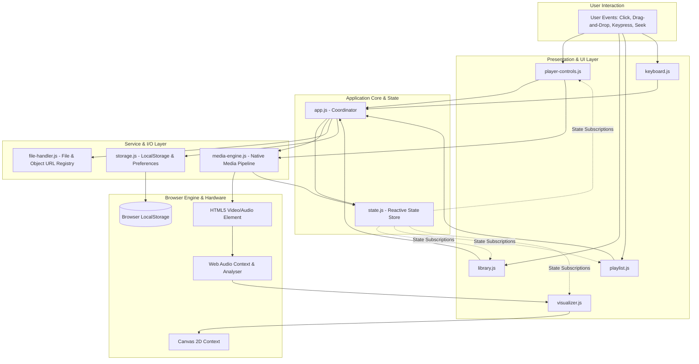
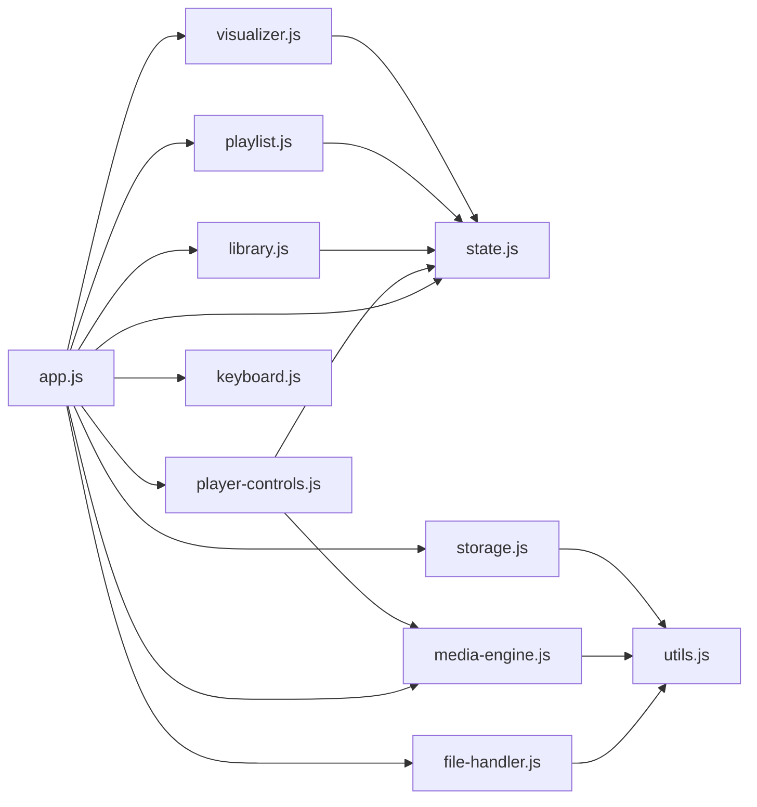
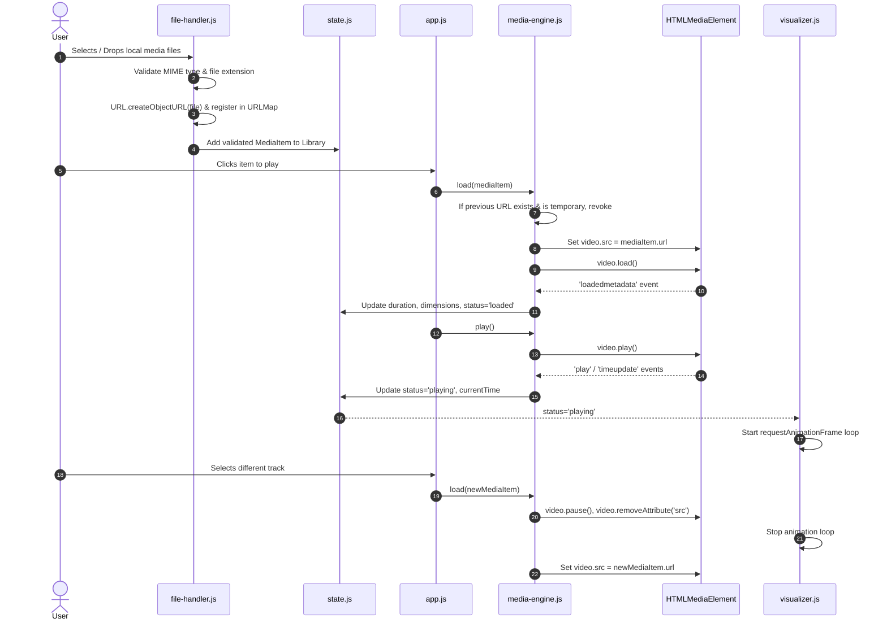
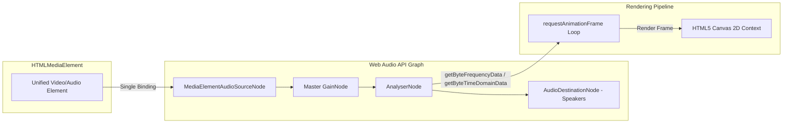
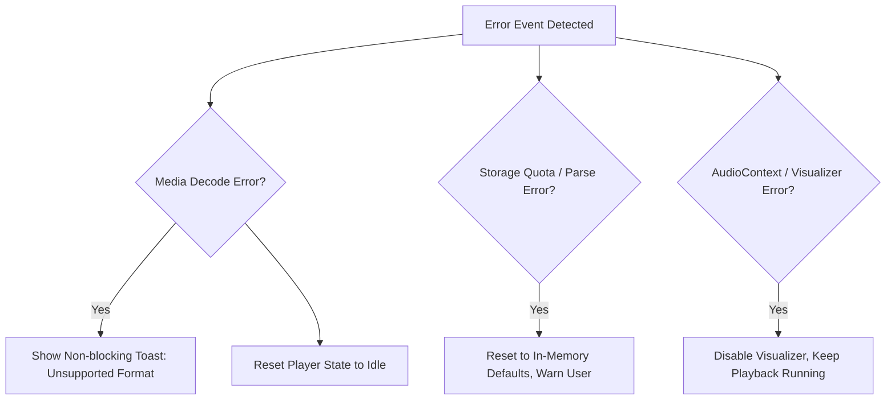

# Sonora — Architecture & Technical Design Specification

## 1. Architectural Overview

**Sonora** is architected as a modular, local-first Single Page Application (SPA) built purely with HTML5, CSS3, and native JavaScript ES Modules. It operates without a backend server, relying entirely on browser-native media APIs, the Web Audio API, Canvas 2D rendering, and client-side storage.

### 1.1 High-Level Architecture Diagram



### 1.2 Architectural Principles
1. **Unidirectional Data Flow**: User interactions invoke actions on the Coordinator (`app.js`) or specific services (`media-engine.js`), which mutate the central `state.js`. Subscribed UI views reactively update in response to state change events.
2. **Single Responsibility & Loose Coupling**: Each module encapsulates a single domain. Modules communicate using explicit method invocations downwards and event subscriptions / state listeners upwards.
3. **Strict Resource Ownership**: Every allocated resource (`blob:` URL, `AudioContext`, animation frame, event listener) has a designated lifecycle owner responsible for its creation and disposal.
4. **Resilient Failure Isolation**: A failure in secondary features (such as audio visualization or thumbnail extraction) never disrupts or halts core audio/video playback.

---

## 2. Module Boundaries & Interface Specifications

The application is decomposed into 11 ES modules located in `/js`:



---

### 2.1 `app.js` — Application Orchestrator & Coordinator
* **Responsibility**: Application entry point. Bootstraps the application, instantiates services, connects event listeners, restores persisted state from `storage.js`, and coordinates high-level workflows (e.g., initiating playback when a library item is clicked).
* **Public Interface**:
  * `init()`: Asynchronously initializes all subsystems and mounts listeners.
  * `playMediaItem(mediaId)`: Coordinates loading a specific item into the media engine.
  * `addFiles(fileList)`: Coordinates validation, registry addition, and library insertion.
* **Data Received**: File objects from drag-and-drop or file pickers, user navigation requests, system error events.
* **Data/Events Produced**: Dispatches initialized system state; emits app-level notification toasts.
* **Dependencies**: `state.js`, `storage.js`, `file-handler.js`, `media-engine.js`, `player-controls.js`, `library.js`, `playlist.js`, `visualizer.js`, `keyboard.js`, `utils.js`.
* **Forbidden Controls**: Must not directly manipulate CSS styles of individual controls or perform low-level audio node manipulation.

---

### 2.2 `state.js` — Centralized Reactive State Store
* **Responsibility**: Holds the canonical, single source of truth for runtime application state. Provides methods to update state immutably and notifies subscribed listeners on state mutations.
* **Public Interface**:
  * `getState()`: Returns a read-only snapshot of current state.
  * `setState(partialStateOrUpdater)`: Updates state and dispatches change events to subscribers.
  * `subscribe(selectorOrKey, listenerCallback)`: Registers a callback triggered when specific state keys change.
  * `reset()`: Resets transient playback and UI state to initial values.
* **Data Received**: State patch objects or updater functions from authorized modules.
* **Data/Events Produced**: Emits `statechange` events with `(currentState, previousState, changedKeys)`.
* **Dependencies**: None (pure JavaScript module).
* **Forbidden Controls**: Must not perform DOM manipulation, file I/O, or media playback calls.

---

### 2.3 `storage.js` — Persistence Adapter
* **Responsibility**: Manages reading, writing, validating, and migrating persistent user preferences and metadata in browser `localStorage`.
* **Public Interface**:
  * `loadPreferences()`: Returns validated user settings (volume, speed, theme, etc.).
  * `savePreferences(prefs)`: Serializes and stores settings.
  * `loadLibraryIndex()`: Retrieves serializable media catalog metadata.
  * `saveLibraryIndex(catalog)`: Persists metadata (names, sizes, durations; never file buffers).
  * `loadPlaylists()` / `savePlaylists(playlists)`: Persists user-created playlists.
  * `clearAll()`: Flushes application keys safely.
* **Data Received**: Serializable JavaScript objects and primitive values.
* **Data/Events Produced**: Emits storage status or quota warnings.
* **Dependencies**: `utils.js`.
* **Forbidden Controls**: Must not store `File`, `Blob`, or object URL strings; must not touch DOM elements.

---

### 2.4 `file-handler.js` — File Ingestion & Object URL Registry
* **Responsibility**: Handles file input selection, drag-and-drop ingestion, file MIME-type/extension validation, unique ID generation, and strict object URL lifecycle tracking.
* **Public Interface**:
  * `processFileList(fileList)`: Validates and converts `FileList` / `Array<File>` into structured `MediaItem` records.
  * `createMediaUrl(file)`: Creates a tracked `blob:` URL via `URL.createObjectURL()`.
  * `revokeMediaUrl(id)`: Explicitly revokes and deletes a tracked object URL.
  * `revokeAllUrls()`: Revokes all active URLs during app teardown or reset.
  * `isSupportedFormat(file)`: Evaluates container and extension against support list.
* **Data Received**: Native `File` and `FileList` objects.
* **Data/Events Produced**: Emits validated `MediaItem` descriptors `{ id, file, url, name, size, type, extension, duration: 0 }`.
* **Dependencies**: `utils.js`.
* **Forbidden Controls**: Must not control the media player element or render UI views directly.

---

### 2.5 `media-engine.js` — Unified Media Playback Pipeline
* **Responsibility**: Wraps and controls a single native HTML5 `<video>` element (which handles both audio and video streams). Translates native media events (`loadedmetadata`, `timeupdate`, `play`, `pause`, `ended`, `error`, `volumechange`) into Sonora state updates.
* **Public Interface**:
  * `init(videoElement)`: Mounts native event listeners to the media element.
  * `load(mediaItem)`: Sets media source (`src = mediaItem.url`), resets time, and begins loading.
  * `play()` / `pause()` / `togglePlay()`: Controls playback state.
  * `seek(seconds)`: Sets `currentTime` within valid duration boundaries.
  * `setVolume(volume)`: Clamps and applies volume `[0.0, 1.0]`.
  * `setMuted(isMuted)`: Toggles audio mute state.
  * `setPlaybackRate(rate)`: Sets playback speed `[0.25, 2.0]` with pitch preservation enabled.
  * `getMediaElement()`: Returns reference for Web Audio node connection.
  * `cleanup()`: Stops playback, clears `src`, and releases media element references.
* **Data Received**: Media source URLs, playback commands (play, pause, seek, volume).
* **Data/Events Produced**: Emits normalized playback status events to `state.js`.
* **Dependencies**: `state.js`, `utils.js`.
* **Forbidden Controls**: Must not directly modify UI elements outside the `<video>` container; must not manage playlist ordering.

---

### 2.6 `player-controls.js` — Media Controls & Scrubber UI
* **Responsibility**: Binds custom UI transport controls (Play/Pause, Skip 10s, Replay 10s, Volume, Mute, Speed, Fullscreen, PiP) and manages timeline scrubber drag interactions.
* **Public Interface**:
  * `init(domContainer)`: Queries control elements and binds event listeners.
  * `updateTime(currentTime, duration)`: Updates time displays and scrubber progress.
  * `updatePlaybackState(isPlaying)`: Updates play/pause icon states.
  * `updateVolume(volume, isMuted)`: Synchronizes slider and volume icon glyphs.
* **Data Received**: Playback state snapshots from `state.js`.
* **Data/Events Produced**: Dispatches user intent to `media-engine.js` and `app.js`.
* **Dependencies**: `media-engine.js`, `state.js`, `utils.js`.
* **Forbidden Controls**: Must not mutate playlists or directly decode audio data.

---

### 2.7 `library.js` — Media Library, Search & Thumbnail Extraction
* **Responsibility**: Renders the library catalog in grid or table views, provides instant search filtering and multi-column sorting, and extracts video frame thumbnails using off-screen canvas elements.
* **Public Interface**:
  * `init(domContainer)`: Mounts library view, search inputs, and filter buttons.
  * `render(mediaItems)`: Renders catalog cards with duration, format badge, and thumbnail.
  * `setFilter(type)`: Filters view by 'all' | 'video' | 'audio'.
  * `setSearchQuery(query)`: Filters items in real time.
  * `setSort(criterion, direction)`: Sorts items by name, date, duration, or size.
  * `generateThumbnail(mediaItem)`: Asynchronously captures frame thumbnail at 1s mark.
* **Data Received**: Media item lists from `state.js`, search inputs from user.
* **Data/Events Produced**: Dispatches track selection events to `app.js`.
* **Dependencies**: `state.js`, `utils.js`.
* **Forbidden Controls**: Must not directly control playback or modify storage directly.

---

### 2.8 `playlist.js` — Queue Management & Playlist Operations
* **Responsibility**: Manages the active playback queue, handles Next/Previous track resolution, implements Shuffle (Fisher-Yates) and Repeat modes (Off, All, One), and supports user-created playlists.
* **Public Interface**:
  * `init(domContainer)`: Mounts queue and playlist sidebars/modals.
  * `getNextTrack()`: Resolves the next track ID based on repeat/shuffle settings.
  * `getPreviousTrack()`: Resolves previous track ID.
  * `addToQueue(mediaItem)` / `removeFromQueue(id)`: Modifies active queue.
  * `createPlaylist(name)` / `deletePlaylist(playlistId)`: Manages playlists.
  * `setRepeatMode(mode)` / `toggleShuffle()`: Updates queue progression logic.
* **Data Received**: Media items, queue reorder events, repeat/shuffle toggles.
* **Data/Events Produced**: Emits active queue updates and resolved next tracks to `state.js`.
* **Dependencies**: `state.js`, `storage.js`, `utils.js`.
* **Forbidden Controls**: Must not directly touch the native media element.

---

### 2.9 `visualizer.js` — Web Audio Graph & Canvas 2D Renderer
* **Responsibility**: Manages the Web Audio API context, creates and attaches `AnalyserNode`, and renders real-time audio visualizations on an HTML5 `<canvas>` using `requestAnimationFrame`.
* **Public Interface**:
  * `init(canvasElement, mediaElement)`: Configures canvas context and connects audio graph safely.
  * `setMode(mode)`: Switches visualization mode ('bars' | 'wave' | 'pulse' | 'off').
  * `start()`: Resumes `AudioContext` and starts the `requestAnimationFrame` loop.
  * `stop()`: Halts the animation loop to conserve CPU when paused or hidden.
  * `resize()`: Recomputes canvas resolution to match pixel density (`devicePixelRatio`).
  * `cleanup()`: Disconnects nodes and terminates animation.
* **Data Received**: Media element audio output stream, mode selection from `state.js`.
* **Data/Events Produced**: None (pure visual rendering sink).
* **Dependencies**: `state.js`, `utils.js`.
* **Forbidden Controls**: Must never pause, play, or interrupt media playback on audio errors.

---

### 2.10 `keyboard.js` — Keyboard Shortcut Registry
* **Responsibility**: Centralizes keyboard shortcuts, intercepts keydown events, checks active focus to avoid collisions with inputs, and triggers corresponding actions.
* **Public Interface**:
  * `init()`: Binds global `keydown` listener to `window`.
  * `destroy()`: Unbinds listeners.
  * `registerShortcut(keyCombination, actionCallback, description)`: Registers a shortcut.
* **Key Bindings**:
  * `Space` / `K`: Toggle Play / Pause.
  * `ArrowLeft` / `J`: Seek Backward 5s / 10s.
  * `ArrowRight` / `L`: Seek Forward 5s / 10s.
  * `ArrowUp` / `ArrowDown`: Increase / Decrease Volume by 5%.
  * `M`: Toggle Mute.
  * `F`: Toggle Fullscreen.
  * `P`: Toggle Picture-in-Picture.
  * `N` / `Shift+N`: Next Track.
  * `P` / `Shift+P`: Previous Track.
  * `0`–`9`: Seek to 0%–90% of duration.
* **Data Received**: Native browser `KeyboardEvent`.
* **Data/Events Produced**: Invokes registered coordinator actions.
* **Dependencies**: `app.js`.
* **Forbidden Controls**: Must not perform UI DOM manipulation.

---

### 2.11 `utils.js` — Reusable Utility Functions
* **Responsibility**: Pure, stateless helper functions used across modules.
* **Public Interface**:
  * `formatTime(seconds)`: Formats time as `MM:SS` or `HH:MM:SS`.
  * `formatBytes(bytes)`: Formats file size as `KB`, `MB`, or `GB`.
  * `debounce(func, waitMs)`: Prevents excessive execution of high-frequency events.
  * `throttle(func, limitMs)`: Restricts execution rate for animation/resize handlers.
  * `clamp(val, min, max)`: Bounds numerical values.
  * `generateId()`: Generates unique alphanumeric identifiers.
  * `escapeHtml(string)`: Sanitizes user strings to prevent XSS.
* **Dependencies**: None.

---

## 3. Application State Model

The application state is managed as a single immutable tree with strictly categorized properties.

```mermaid
graph TD
    Root[Central State Tree]
    Root --> PB[Playback State - Transient]
    Root --> LIB[Library State - Mixed]
    Root --> PL[Playlist State - Persisted]
    Root --> UI[UI State - Transient]
    Root --> PREF[Preferences State - Persisted]

    PB --> PB1[currentTrackId: string | null]
    PB --> PB2[status: 'idle'|'loading'|'playing'|'paused'|'ended'|'error']
    PB --> PB3[currentTime: number]
    PB --> PB4[duration: number]
    PB --> PB5[volume: number 0..1]
    PB --> PB6[isMuted: boolean]
    PB --> PB7[playbackRate: number]
    PB --> PB8[bufferedRanges: Array]

    LIB --> LIB1[items: Map<id, MediaItem>]
    LIB --> LIB2[searchQuery: string]
    LIB --> LIB3[filterType: 'all'|'video'|'audio']
    LIB --> LIB4[sortKey: 'name'|'date'|'duration'|'size']
    LIB --> LIB5[sortDirection: 'asc'|'desc']
    LIB --> LIB6[favourites: Set<string>]
    LIB --> LIB7[history: Array<HistoryEntry>]

    PL --> PL1[activeQueue: Array<string>]
    PL --> PL2[currentIndex: number]
    PL --> PL3[repeatMode: 'off'|'all'|'one']
    PL --> PL4[shuffleEnabled: boolean]
    PL --> PL5[playlists: Map<id, Playlist>]

    UI --> UI1[currentView: 'library'|'nowPlaying'|'visualizer'|'playlists']
    UI --> UI2[visualizerMode: 'bars'|'wave'|'pulse']
    UI --> UI3[isFullscreen: boolean]
    UI --> UI4[isPiPActive: boolean]
    UI --> UI5[activeModal: string | null]
    UI --> UI6[notifications: Array<Toast>]

    PREF --> PREF1[themeAccent: string]
    PREF --> PREF2[savedVolume: number]
    PREF --> PREF3[savedPlaybackRate: number]
```

### 3.1 State Categorization Matrix

| State Domain | Property | Lifecycle Type | Storage Target | Description |
| :--- | :--- | :---: | :---: | :--- |
| **Playback** | `currentTrackId` | Transient | In-Memory | Active track being loaded or played |
| | `status` | Transient | In-Memory | Engine status: idle, loading, playing, paused, ended, error |
| | `currentTime` | Transient | In-Memory | Current playback offset in seconds |
| | `duration` | Transient | In-Memory | Total duration of current media item |
| | `volume` | Persisted | `localStorage` | Audio gain level (0.0 to 1.0) |
| | `isMuted` | Persisted | `localStorage` | Mute toggle state |
| | `playbackRate` | Persisted | `localStorage` | Playback speed factor (e.g. 1.0, 1.5) |
| | `bufferedRanges` | Transient | In-Memory | Media element buffer time ranges |
| **Library** | `items` | Transient + Index | In-Memory (`File` objects) + `localStorage` (metadata) | Ingested media items in session |
| | `searchQuery` | Transient | In-Memory | Active text query in library search |
| | `filterType` | Transient | In-Memory | Active media format filter |
| | `sortKey` / `sortDir` | Persisted | `localStorage` | Active sorting column and direction |
| | `favourites` | Persisted | `localStorage` | Set of media IDs or filename hashes |
| | `history` | Persisted | `localStorage` | Array of recently played items (max 50) |
| **Playlist** | `activeQueue` | Transient | In-Memory | Sequence of media item IDs in current queue |
| | `currentIndex` | Transient | In-Memory | Index of playing track within active queue |
| | `repeatMode` | Persisted | `localStorage` | 'off' \| 'all' \| 'one' |
| | `shuffleEnabled` | Persisted | `localStorage` | Shuffle state |
| | `playlists` | Persisted | `localStorage` | Custom user-created playlists metadata |
| **UI** | `currentView` | Transient | In-Memory | 'library' \| 'nowPlaying' \| 'visualizer' |
| | `visualizerMode` | Persisted | `localStorage` | 'bars' \| 'wave' \| 'pulse' \| 'off' |
| | `isFullscreen` | Transient | In-Memory | Native fullscreen active state |
| | `isPiPActive` | Transient | In-Memory | Picture-in-Picture active state |
| | `notifications` | Transient | In-Memory | Active error / info toast queue |

### 3.2 Framework-Free Reactivity Model
To achieve fine-grained reactivity without external dependencies or DOM diffing engines, `state.js` implements a lightweight **Observable Store Pattern**:

```javascript
// Conceptual Architecture of state.js
const state = { ...initialState };
const listeners = new Map(); // Map<key, Set<Callback>>

export function subscribe(key, callback) {
  if (!listeners.has(key)) listeners.set(key, new Set());
  listeners.get(key).add(callback);
  return () => listeners.get(key).delete(callback); // Unsubscribe
}

export function setState(updates) {
  const changedKeys = [];
  for (const [key, value] of Object.entries(updates)) {
    if (state[key] !== value) {
      state[key] = value;
      changedKeys.push(key);
    }
  }
  for (const key of changedKeys) {
    if (listeners.has(key)) {
      listeners.get(key).forEach(cb => cb(state[key], state));
    }
  }
}
```

Components subscribe only to keys they render. For example, `player-controls.js` subscribes to `currentTime`, `duration`, `status`, and `volume`, while `library.js` subscribes to `items`, `searchQuery`, and `filterType`. This prevents unnecessary DOM re-renders.

---

## 4. Media Lifecycle & Resource Safety

Managing local media files in a browser requires strict resource governance. Because `blob:` URLs occupy memory in the browser process until explicitly revoked, Sonora implements a deterministic **Object URL Registry**.



### 4.1 Step-by-Step Media Lifecycle

1. **Selection & Ingestion**:
   * User drops files onto the drop zone or selects via file picker.
   * `file-handler.js` validates files against supported extensions (`.mp3`, `.wav`, `.ogg`, `.aac`, `.flac`, `.m4a`, `.mp4`, `.webm`, `.ogv`, `.mov`).
   * For each valid file, an immutable `MediaItem` is generated with a unique ID, metadata, and an initial object URL.
2. **Object URL Registry**:
   * All generated URLs are indexed in `ObjectUrlRegistry = new Map<id, { url, file, refCount }>()`.
   * Object URLs are **never** persisted to `localStorage` because they become invalid upon page refresh.
3. **Unified `<video>` Element Strategy**:
   * Sonora uses a single `<video>` element for both audio and video playback.
   * *Rationale*: In HTML5, `<video>` plays audio files identically to an `<audio>` element. Using a single element eliminates the complexity of synchronizing two elements and guarantees that Web Audio `MediaElementAudioSourceNode` remains bound to a single DOM node throughout the session.
4. **Playback Transition & Teardown**:
   * Before a new track is loaded:
     1. Playback is paused (`video.pause()`).
     2. Video source is cleared (`video.removeAttribute('src')`, followed by `video.load()`) to immediately release media decoders and hardware acceleration pipelines.
     3. If the outgoing track's object URL is marked for eviction (e.g., deleted from library), `URL.revokeObjectURL(url)` is invoked.
5. **Application Shutdown / Reload**:
   * On `window.addEventListener('beforeunload')`:
     * All registered object URLs are revoked via `URL.revokeObjectURL()`.
     * `AudioContext` is closed via `audioCtx.close()`.
     * The `requestAnimationFrame` loop is cancelled.

---

## 5. Audio Visualization Architecture



### 5.1 Critical Architectural Constraints
* **Single Binding Rule**: The Web Audio specification mandates that `audioContext.createMediaElementSource(HTMLMediaElement)` can only be called **once** per media element instance. Calling it a second time throws an `InvalidStateError`.
  * *Architecture Solution*: The audio graph is instantiated **once** during initialization in `visualizer.js`. The source node remains connected through a master `GainNode` to the `AnalyserNode` and `audioContext.destination`.
* **Autoplay & AudioContext Suspension**:
  * Browsers automatically initialize `AudioContext` in a `'suspended'` state if created before a user interaction.
  * *Architecture Solution*: Sonora checks `if (audioCtx.state === 'suspended') audioCtx.resume()` inside the first user gesture (e.g., clicking Play or selecting a track).
* **Fault Isolation**:
  * All Web Audio operations are wrapped in `try...catch` blocks.
  * If Web Audio or Canvas is blocked (e.g., security restrictions, headless browsers, or hardware acceleration failure), the error is logged, visualizer state is set to `'disabled'`, and normal audio/video playback continues without interruption.

### 5.2 Visualization Modes
1. **Spectrum Bars (`bars`)**: Renders FFT frequency bands (`analyser.getByteFrequencyData()`) with a violet-to-cyan gradient and peak falloff physics.
2. **Oscilloscope Waveform (`wave`)**: Renders real-time time-domain waveform (`analyser.getByteTimeDomainData()`) with antialiased bezier curves.
3. **Circular Audio Pulse (`pulse`)**: Renders radial frequency spikes pulsing outward from a central orb, ideal for music listening.

---

## 6. Data Persistence Strategy

Sonora utilizes `localStorage` exclusively for lightweight, serializable user preferences and catalog metadata. **No media binary data, Blob objects, or base64 data URLs are ever written to `localStorage`.**

### 6.1 Schema & Versioning
Storage keys are strictly namespaced with a version tag: `sonora_v1_*`.

```json
{
  "sonora_v1_preferences": {
    "version": 1,
    "volume": 0.85,
    "isMuted": false,
    "playbackRate": 1.0,
    "visualizerMode": "bars",
    "themeAccent": "violet",
    "repeatMode": "all",
    "shuffleEnabled": false,
    "libraryView": "grid"
  },
  "sonora_v1_library_index": [
    {
      "id": "trk_9f83a",
      "name": "Solaris_Theme.mp3",
      "size": 8492042,
      "type": "audio/mpeg",
      "duration": 248.5,
      "lastModified": 1729600000000,
      "isFavourite": true,
      "addedAt": 1729601200000
    }
  ],
  "sonora_v1_playlists": [
    {
      "id": "pl_01",
      "name": "Cinematic Soundtracks",
      "itemIds": ["trk_9f83a"]
    }
  ],
  "sonora_v1_history": [
    {
      "name": "Solaris_Theme.mp3",
      "playedAt": 1729605000000
    }
  ]
}
```

### 6.2 Handling Session Restarts & Missing Files
* When the browser is refreshed or reopened, `File` objects in memory are discarded by the browser sandbox.
* Sonora reads `sonora_v1_library_index` on startup and displays previously loaded media items in an **"Offline / Re-link Required"** state.
* If the user re-selects the file or folder, Sonora matches items by `name`, `size`, and `lastModified` timestamp, instantly restoring the active object URLs without losing playlist structures or favourites.

### 6.3 Future Progressive Enhancement: File System Access API
* On supported Chromium browsers, Sonora can optionally leverage `window.showOpenFilePicker()` to store `FileSystemFileHandle` references in `IndexedDB`.
* This allows re-requesting read permission on subsequent sessions without requiring manual file re-selection. However, this is strictly an enhancement; standard file selection remains the primary baseline.

---

## 7. Visual Design System & CSS Architecture

Sonora features a dark, cinematic UI aesthetic. Surfaces use near-black and charcoal tones, complemented by a signature electric violet accent that highlights active states, scrubber progress, and visualization peaks.

### 7.1 Design Tokens (`css/variables.css`)

```css
:root {
  /* Color Palette - Surfaces & Backgrounds */
  --sn-bg-base: #0B0C10;           /* Deep obsidian background */
  --sn-bg-surface: #14161D;        /* Primary panel surface */
  --sn-bg-surface-elevated: #1C1F2B;/* Cards, popovers, dropdowns */
  --sn-bg-surface-hover: #25293A;   /* Interactive hover surface */
  --sn-bg-overlay: rgba(11, 12, 16, 0.85);

  /* Color Palette - Borders & Dividers */
  --sn-border-subtle: rgba(255, 255, 255, 0.06);
  --sn-border-medium: rgba(255, 255, 255, 0.12);
  --sn-border-focus: rgba(139, 92, 246, 0.6);

  /* Brand Accents - Electric Violet */
  --sn-accent-primary: #8B5CF6;     /* Main action violet */
  --sn-accent-hover: #9D74FF;       /* Hover state */
  --sn-accent-active: #7C3AED;      /* Pressed state */
  --sn-accent-glow: rgba(139, 92, 246, 0.35);
  --sn-accent-gradient: linear-gradient(135deg, #8B5CF6 0%, #6366F1 100%);

  /* Typography Colors */
  --sn-text-primary: #F3F4F6;       /* High-contrast headers & titles */
  --sn-text-secondary: #9CA3AF;     /* Metadata, secondary labels */
  --sn-text-muted: #6B7280;         /* Disabled, timestamps, placeholders */
  --sn-text-inverse: #0B0C10;

  /* Typography Scale */
  --sn-font-family: -apple-system, BlinkMacSystemFont, "Segoe UI", Roboto, "Inter", sans-serif;
  --sn-font-mono: "SF Mono", "Cascadia Code", "Fira Code", monospace;
  --sn-text-xs: 0.75rem;            /* 12px */
  --sn-text-sm: 0.875rem;           /* 14px */
  --sn-text-base: 1.0rem;           /* 16px */
  --sn-text-lg: 1.125rem;           /* 18px */
  --sn-text-xl: 1.25rem;            /* 20px */
  --sn-text-2xl: 1.5rem;            /* 24px */

  /* Spacing Scale (4px / 8px Grid) */
  --sn-space-1: 4px;
  --sn-space-2: 8px;
  --sn-space-3: 12px;
  --sn-space-4: 16px;
  --sn-space-6: 24px;
  --sn-space-8: 32px;
  --sn-space-12: 48px;

  /* Border Radii */
  --sn-radius-sm: 4px;
  --sn-radius-md: 8px;
  --sn-radius-lg: 12px;
  --sn-radius-xl: 16px;
  --sn-radius-full: 9999px;

  /* Elevation Shadows */
  --sn-shadow-sm: 0 1px 3px rgba(0, 0, 0, 0.3);
  --sn-shadow-md: 0 4px 12px rgba(0, 0, 0, 0.4);
  --sn-shadow-lg: 0 12px 32px rgba(0, 0, 0, 0.6);
  --sn-shadow-glow: 0 0 20px var(--sn-accent-glow);

  /* Transitions */
  --sn-transition-fast: 150ms cubic-bezier(0.4, 0, 0.2, 1);
  --sn-transition-normal: 250ms cubic-bezier(0.4, 0, 0.2, 1);

  /* Z-Index Hierarchy */
  --sn-z-base: 1;
  --sn-z-controls: 10;
  --sn-z-header: 20;
  --sn-z-sidebar: 30;
  --sn-z-player: 40;
  --sn-z-overlay: 50;
  --sn-z-modal: 100;
  --sn-z-toast: 110;
}
```

### 7.2 Layout Shell Architecture

```
+-------------------------------------------------------------------------+
| Top Navigation Header: Brand Logo | Search Bar | Quick Actions (Import)  |
+-------------------+-----------------------------------------------------+
| Sidebar Nav       | Main Content Viewport                               |
|                   |                                                     |
| - Library         | [ Active View: Library Grid / Video Display ]       |
| - Playlists       |                                                     |
| - Favourites      |                                                     |
| - Visualizer      |                                                     |
| - Settings        |                                                     |
|                   |                                                     |
+-------------------+-----------------------------------------------------+
| Bottom Cinematic Player Bar                                             |
| [Track Info] | [Transport Controls & Scrubber Timeline] | [Vol/Speed/PiP] |
+-------------------------------------------------------------------------+
```

---

## 8. Browser Compatibility & Fallback Matrix

| Web Capability | Standard / API | Modern Desktop (Chrome/Edge/Brave) | Firefox | Safari (macOS / iOS) | Fallback Strategy |
| :--- | :--- | :---: | :---: | :---: | :--- |
| **Media Playback** | `<video>` element | Full | Full | Full | Direct native playback; show error toast on unsupported codecs. |
| **Audio Analysis** | `AudioContext`, `AnalyserNode` | Full | Full | Full (requires user gesture unlock) | Isolate in `try/catch`. If unavailable, disable visualizer gracefully. |
| **Picture-in-Picture** | `HTMLVideoElement.requestPictureInPicture` | Full | Full | Prefix / Platform specific | Capability detection (`'pictureInPictureEnabled' in document`). Hide PiP button if unsupported. |
| **Fullscreen** | `Element.requestFullscreen` | Full | Full | Prefix (`webkitRequestFullscreen`) | Multi-vendor fallback wrapper in `utils.js`. |
| **Media Session** | `navigator.mediaSession` | Full | Partial | Full (macOS / iOS) | Safe execution guard: `if ('mediaSession' in navigator)`. No impact if missing. |
| **Drag & Drop** | HTML5 Drag & Drop API | Full | Full | Full (Desktop) | File picker fallback always accessible via clicking import button. |

---

## 9. Error Handling & Resilience Strategy



1. **Media Decode & Load Errors**: When the native media element triggers an `'error'` event, the engine intercepts `mediaElement.error.code` (e.g. `MEDIA_ERR_SRC_NOT_SUPPORTED`, `MEDIA_ERR_DECODE`), updates state to `status: 'error'`, resets the transport controls, and triggers a helpful user toast with suggested playable formats.
2. **Storage Quota & Parse Resilience**: In `storage.js`, all `localStorage.getItem` and `setItem` calls are guarded. If `JSON.parse` encounters malformed syntax, the corrupt key is safely removed and replaced with clean defaults without crashing the app.
3. **Web Audio Decoupling**: Visualizer setup failures never block media playback. If `createMediaElementSource` fails, the visualizer gracefully enters an inactive state while normal audio playback proceeds through standard element output.

---

## 10. Architectural Decision Records (ADRs)

### ADR-01: Vanilla ES Modules Without Bundlers or Build Step
* **Status**: Accepted.
* **Context**: Modern web development often defaults to Vite, Webpack, or TypeScript.
* **Decision**: Build Sonora exclusively with native browser ES Modules (`<script type="module">`).
* **Rationale**: Eliminates build-step friction, keeps source files directly debuggable in Chrome DevTools without source maps, avoids node_modules bloat, and aligns with the project constraint of being runnable via any static HTTP server.

### ADR-02: Unified `<video>` Element for Audio & Video
* **Status**: Accepted.
* **Context**: Need to support both video files (`.mp4`, `.webm`) and audio files (`.mp3`, `.wav`, `.flac`).
* **Decision**: Use a single HTML5 `<video>` element for all media playback.
* **Rationale**: An HTML5 `<video>` element can play both audio and video natively. Using a single element prevents the Web Audio `createMediaElementSource()` single-call restriction from causing issues when toggling between video and audio tracks, simplifies event binding, and streamlines player controls.

### ADR-03: Reactive Pub/Sub Store in Vanilla JS
* **Status**: Accepted.
* **Context**: Need synchronized UI updates across scrubber, library, playlists, and visualizer without bringing in heavy libraries like Redux or MobX.
* **Decision**: Implement a key-based Pub/Sub store in `state.js`.
* **Rationale**: Provides predictable state flow, isolates state mutations, enables modular testing, and guarantees responsive UI updates under 1ms overhead.

### ADR-04: Strict Object URL Registry
* **Status**: Accepted.
* **Context**: `URL.createObjectURL()` causes memory leaks if Blobs are not explicitly revoked.
* **Decision**: Centralize all creation and revocation inside `file-handler.js` via an `ObjectUrlRegistry` and hook into `window.beforeunload`.
* **Rationale**: Guarantees zero memory leakage across long playback sessions with dozens of track changes.

### ADR-05: Canvas 2D Over WebGL for Audio Visualization
* **Status**: Accepted.
* **Context**: Selecting rendering technology for the visualizer.
* **Decision**: Use `CanvasRenderingContext2D`.
* **Rationale**: Canvas 2D is lightweight, highly performant for 64–256 frequency bars and waveforms, has universal browser support, and avoids WebGL shader compilation overhead.
