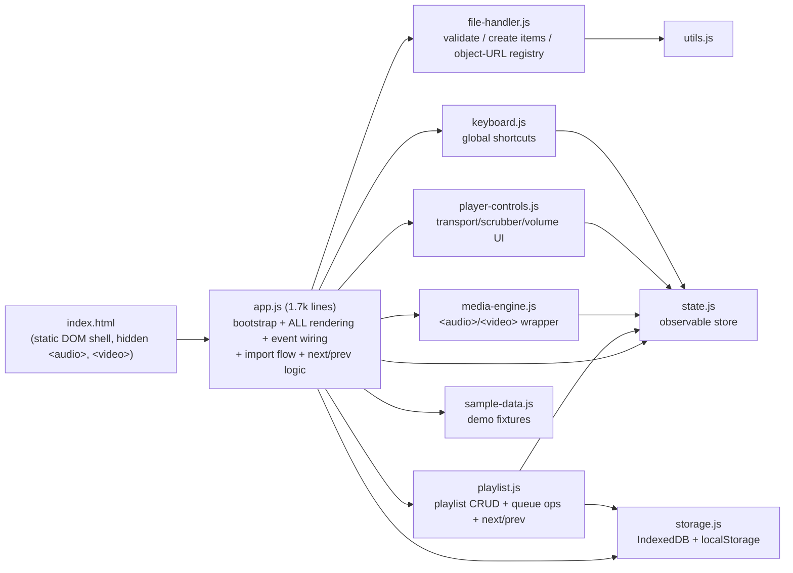
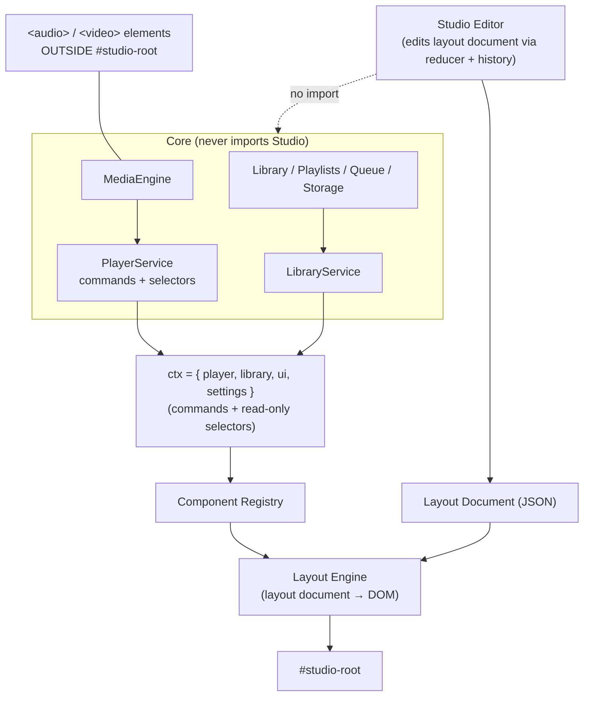

# Sonora — Architecture

> Rewritten in **Phase 0.5** from inspection of commit `a42bd9c`. The original Phase 0 specification (which described several modules that were never built) is in git history: `git show a12dfb4:ARCHITECTURE.md`.
> Roadmap, defect list (`D-nn`) and acceptance criteria (`AC-nn`) live in [`PLAN.md`](PLAN.md). Decision records live in [`docs/DECISIONS.md`](docs/DECISIONS.md).

**Labels.** Every section is marked **[EXISTING]** (describes code that is in the repository) or **[PROPOSED]** (design, not implemented). Evidence tags: **[V]** verified by running, **[C]** read from code, **[U]** unverified claim that must be validated.

**Constraints that shape every decision**
1. Preserve working behaviour; no rewrite, no framework migration (no Next.js etc.) without a concrete technical need.
2. Local files never leave the browser. No audio in MongoDB; no audio in `localStorage`.
3. Online/accounts/Studio are designed for but not introduced early.
4. Must remain deployable on Vercel; Docker is for reproducibility and for services Vercel can't host well.
5. Academic project: reliability and clarity over technology showcase.

---

## 1. Existing architecture **[EXISTING]**

Static single-page app: `index.html` + `css/*.css` + native ES modules (`js/*.js`). No build step, no `package.json`, no runtime dependencies, no server.



### 1.1 Module responsibilities **[EXISTING]**

| Module | Actual responsibility | Notes |
| :-- | :-- | :-- |
| `app.js` | Bootstraps (IndexedDB open, restore, seed defaults), caches ~70 DOM nodes at import time, renders every view with `innerHTML` strings, binds all events, orchestrates import/relink, decides next/prev, modals, toasts. | God module. Runs `init()` on import and touches `document`/`window` at import, so it cannot be loaded in Node. **Contains D-01.** Also hosts the Studio-blocking coupling (see §6.1). |
| `state.js` | Observable key-based store (`getState`, `setState`, `setPlaybackState`, `subscribe`, `'*'` wildcard). Shallow identity compare; collections (`Map`/`Set`/array) are replaced, not mutated, by convention. | Pure; imports fine in Node [V]. The engine mutates item objects in place (`currentMediaItem.duration = …`), bypassing the store (D-17). |
| `storage.js` | `StorageAdapter`: IndexedDB `sonora_db` v1 with stores `library, playlists, favourites, history, queue, blobs`; `localStorage` key `sonora_v1_preferences`. | Every failure → `resolve(false)`/`[]` (D-16). `blobs` store is dead (D-15). |
| `file-handler.js` | Validates files (MIME prefix, then extension), builds media items (title from filename; placeholder artist/genre; SVG poster), duplicate heuristic (`name`+`size`+`lastModified`±2 s), `ObjectUrlRegistry` (`Map<id,url>`), `relinkMediaItem`, `beforeunload` revoke. | Touches `window` at import. Relink/dedupe contain D-03/04/05/13. |
| `media-engine.js` | `MediaEngine` singleton over two elements (`<audio>` for audio, `<video>` for video); one active element; normalised events → `state.playback`; `load/play/pause/togglePlay/seek/setVolume/setMuted/setPlaybackRate`; `onTrackEnded`/`onError` single-callback hooks. | No event emitter (root of D-01/D-02). `isSeeking` and `cleanup()` unused. No stale-load token (`AbortError` is swallowed instead). |
| `player-controls.js` | Binds transport buttons, scrubber (commit on `change`), volume, mute, speed cycle; renders play/pause icon, time, ARIA values. | Fine boundary; takes a `mediaEngine` and callbacks. |
| `keyboard.js` | Global `keydown`: Space/K, ←/→, J/L, ↑/↓, M, N/P, 0–9. Guard: ignores `input/textarea/select/contentEditable` and modifier combos. | Doesn't guard focused buttons/cards (D-10). `P` doesn't share the button's "restart if >3 s" rule. |
| `playlist.js` | `PlaylistManager`: playlist CRUD (persisted), queue add/remove/clear/reorder/append, `getNextTrack/getPreviousTrack`. | Imports in Node; with `storage.isAvailable === false` every storage call is a no-op → queue/playlist logic is unit-testable today [V import; C logic]. |
| `utils.js` | `formatTime`, `formatBytes`, `escapeHtml`, `debounce`, `clamp`, `generateId`. | Pure. |
| `sample-data.js` | 8 fixture items with SVG covers and no media URL. | Seeded into the **real** library (D-08). |

**Not present despite the old spec:** `library.js`, `visualizer.js`, any Web Audio code, Media Session, Fullscreen, PiP [V via grep].

### 1.2 Browser APIs used **[EXISTING]**
`HTMLMediaElement` (`<audio>`, `<video>`, `preservesPitch`), `URL.createObjectURL/revokeObjectURL`, File API / `<input type=file multiple>`, HTML5 Drag-and-Drop (`dataTransfer.files`), IndexedDB, `localStorage`, `requestAnimationFrame`, native ES modules, `window.confirm()`. **Not used:** File System Access API, `webkitdirectory`, OPFS, `navigator.storage`, Web Audio, Media Session, service workers.

### 1.3 CSS architecture **[EXISTING]**
`variables.css` (design tokens `--sn-*`: palette, type scale, spacing, radii, shadows, z-index, player/header/sidebar sizes) → `reset.css` → `layout.css` (app shell grid: sidebar, header, viewport, player bar, queue drawer) → `components.css` → `player.css` → `library.css` → `visualizer.css` (scaffold only) → `responsive.css` (breakpoints 1440/1024/768/480). Token-driven styling is the asset Studio will build on (§6).

### 1.4 State model **[EXISTING]**
Keys (`state.js`): navigation (`currentView`, `isSidebarOpen`, `isQueueOpen`, `isDragOver`), library (`items: Map`, `searchQuery`, `filterType`, `sortKey/sortDir`, `selectedMediaId`, `favourites: Set`, `history`), `playlists: Map`, `activePlaylistId`, queue (`activeQueue: id[]`, `currentIndex` *unused*, `repeatMode`, `shuffleEnabled`), modals (`activeModal`, `modalData`), and `playback` `{status, currentTrackId, currentTime, duration, volume, isMuted, playbackRate, error}`.

Structural weaknesses **[C]**:
- **Two "current track" notions.** `selectedMediaId` (what is highlighted/in hero) and `playback.currentTrackId` (what the element is playing). `playNextTrack()`/`playPrevTrack()` compute from **`selectedMediaId`**, so clicking a card of an *offline* track (which selects but does not load) moves the "next" origin while another track keeps playing. (Added as D-26 in PLAN.)
- Queue position is derived by `indexOf(id)` each time, so it cannot represent the same track twice or an index independent of the track.
- Every `setState({items: new Map(...)})` triggers a full catalogue `innerHTML` rebuild and listener re-attachment.
- Dozens of inline `style=""` strings in `app.js` templates — an obstacle to theming.

---

## 2. Native-file player — current flow **[EXISTING]**

```mermaid
sequenceDiagram
    participant U as User
    participant A as app.js
    participant F as file-handler.js
    participant S as storage.js
    participant E as media-engine.js
    U->>A: pick / drop files
    A->>F: processFiles(files)   (empty "existing" map)
    F-->>A: accepted[] (each already has a blob: URL), rejected[]
    A->>A: second dedupe pass vs library (discarded duplicates leak URLs; relink return value dropped)
    A->>S: saveLibraryItem (metadata only, incl. SVG data URL)
    A->>A: setState(items, queue) ; first new item → loadAndPlayItem
    A->>E: load(item, autoPlay)   (needs item.url)
    E-->>A: state.playback updates (timeupdate ≈4 Hz)
    E-->>A: onTrackEnded → playNextTrack (from selectedMediaId)
```

After reload: `library` records return with `isOffline = true` and no `file`/`url`; the UI shows an "Offline" badge and a relink modal that — as committed — does not relink (D-03/04).

---

## 3. Proposed native-player changes **[PROPOSED]**

Principle: *extract and fix*, don't rewrite. Each change is small, individually testable, and lands in Phase A/B.

### 3.1 Engine: events, load tokens, error policy (A3)
- Add a minimal emitter to `MediaEngine`: `on(event, fn) → off`, events `loaded | playing | paused | ended | error | stalled`. Keep `onTrackEnded/onError` as thin wrappers so nothing else changes. App history recording subscribes to `playing`.
- `load()` increments `this.loadToken`; async continuations (`play()` resolution/rejection) compare against the token and are dropped when stale → removes the need to special-case `AbortError` and prevents a stale rejection from overwriting state.
- On element `error`, set `status:'error'`; the *coordinator* (not the engine) decides policy: mark the item `unplayable` for this session, **skip** to the next playable item, cap at 5 consecutive skips, then stop with a message (AC-06).
- Persist `duration` into the library record on first `loaded` and re-render only that card.

### 3.2 Queue as a pure module (A3)
New `js/queue.js` (pure functions, no DOM, no storage) operating on `{ order: TrackRef[], originalOrder: TrackRef[], index: number, repeat: 'off'|'all'|'one', shuffle: boolean }`:
- `next(q, {auto})`, `prev(q, {positionSeconds})`, `setShuffle(q, on, rng)`, `remove(q, ref)`, `move(q, from, to)`, `playNext(q, ref)`, `enqueue(q, ref)`.
- **Shuffle = permutation:** on enable, `originalOrder` is kept; `order` = current track first, remainder Fisher–Yates-shuffled with an injectable RNG (deterministic tests). Disable → `order = originalOrder` filtered of removed tracks; `index` = position of the current track. Repeat-off ends after the last element; repeat-all reshuffles for the next pass; repeat-one only affects auto-advance, not manual Next.
- Removing the current track advances to its **successor**, not `queue[0]`.
- `index` is persisted (IndexedDB `queue` record gains `index`, `order`, `originalOrder`).
- `selectedMediaId` becomes purely a *view* concern; transport logic uses only the queue's current ref (kills the two-"current" ambiguity).

### 3.3 Import orchestrator (A2)
`file-handler.js` gains one entry point `importFiles(files, library) → { added[], duplicates[], relinked[], rejected[{name,reason}] }`:
1. Validate (MIME/extension, size > 0, `canPlayType` advisory — warn, don't hard-reject, because `canPlayType` is "maybe/probably").
2. Fingerprint each file (`size` + normalised name + `lastModified`), compare to existing records **and** earlier files in the same batch.
3. Match found: if the record is unavailable → *bind* the new `File` to it (same id; playlists/favourites untouched); if the record is live → count as duplicate and **do not touch its URL**.
4. Only after steps 1–3 create object URLs, and only for items that will actually be kept.
5. Return a structured result; the caller shows **one** summary toast.
Binding a `File` to an existing record is one function (`bindFile(record, file)`) used by import, modal-relink and (Phase B) folder reconnect — a single code path for D-03/04/05.

### 3.4 Preferences (A3)
`savePreferences` already merges and writes; the missing piece is calling it from the engine's `volumechange`/`ratechange` and from the repeat/shuffle controls (D-06). `initialState`/prefs defaults must be the *same* object so they can't drift.

### 3.5 First-run vs. empty (A2)
Replace "if the store is empty, seed defaults" with a `meta` record `{ key:'firstRunDone' }`. Defaults (if any) are created exactly once. An empty favourites set, an empty playlist list or an empty queue is a valid user state (D-07).

---

## 4. Persistence — current state **[EXISTING]**

| Data | Store | Notes |
| :-- | :-- | :-- |
| Library metadata | IndexedDB `library` (keyPath `id`; indexes `title,type,addedAt`) | Record includes a per-track SVG data-URL `thumbnail` (wasteful), placeholder artist/genre/year. No `File`, no handle. |
| Playlists | `playlists` | `{id,name,itemIds[],createdAt,updatedAt}`; `updatedAt` is overwritten on every save. |
| Favourites | `favourites` (keyPath `mediaId`) | Saved by `clear()` + re-`put` of the whole set. |
| History | `history` (keyPath `mediaId`) | `{playedAt, playCount}` — one row per track, so "recently played" has no per-play log. Never written (D-02). |
| Queue | `queue` (`id:'active_queue'`) | `itemIds[]` + `currentIndex` (always 0). |
| Blobs | `blobs` | Dead; nothing writes it. |
| Preferences | `localStorage['sonora_v1_preferences']` | Only view/sort/filter are saved in practice (D-06). Merged over defaults; corrupt JSON falls back to defaults but the corrupt key is *not* removed (old spec said it would be). |

Failure behaviour: all adapter methods swallow errors; only a failed `initDB` produces a toast ("memory mode"). There is no distinction between "empty" and "read failed" (D-16 → D-07).

---

## 5. Persistence — proposed design **[PROPOSED]** (Phase B)

### 5.1 Choice of mechanisms

| Mechanism | Use | Why |
| :-- | :-- | :-- |
| **IndexedDB** (already in use) | Library metadata, playlists, favourites, history, queue, artwork blobs, file handles, `meta` | Already the live store; structured, async, large quota. `FileSystemHandle`s are structured-cloneable into IndexedDB (MDN File System API page, fetched in Phase 0.5). |
| **localStorage** | Small synchronous preferences only (volume, mute, speed, repeat, shuffle, sort, filter, view, last layout id) | Already used; synchronous read is convenient at boot before IndexedDB opens. Never blobs or library data. |
| **File System Access API** (`showOpenFilePicker`, `showDirectoryPicker`) | **Progressive enhancement** on Chromium: persist handles to allow *permission re-grant* without re-picking | Picker methods are Chromium-family features [U — confirm current support in MDN/caniuse compat tables; the fetched MDN text omitted the table]. Requires a secure context (HTTPS or `localhost`; verified in MDN text). |
| **`<input type=file multiple>`, `<input webkitdirectory>`, drag-drop** | **Baseline everywhere** | Works in all browsers; yields session-only `File` objects. |
| **OPFS / IndexedDB audio copies** | *Not planned now.* Optional later "keep a copy" opt-in | Doubles disk use, subject to quota/eviction; contradicts "files stay where the user keeps them". |

Rule: the baseline path must be complete and tested on its own; the handle path only *reduces how often the user must reconnect*.

### 5.2 Data model (IndexedDB v2) **[PROPOSED]**

```text
library   { id, trackKey, name, title, artist, album, albumArtist, trackNo, year, genre,
            duration, size, mime, type, lastModified, addedAt, artworkId?, metaSource: 'tags'|'filename' }
            indexes: size, addedAt, artist, album          (availability is NOT stored)
handles   { trackId, handle: FileSystemFileHandle, rootId?, relPath? }
roots     { id, handle: FileSystemDirectoryHandle, name, addedAt }
artwork   { id (content hash), blob, mime }
playlists { id, name, items: TrackRef[], createdAt, updatedAt }       (TrackRef = 'local:<id>' later also '<provider>:<id>')
favourites{ ref, addedAt }
history   { id (auto), ref, playedAt }                                 (per-play log; cap + prune)
queue     { id:'active', order[], originalOrder[], index, repeat, shuffle }
meta      { key, value }   -- schemaVersion, firstRunDone, lastBackupAt, …
```
- **Playback state ≠ library state.** The queue record references tracks by ref; engine position/volume live in preferences. Nothing in `library` is touched by playback.
- **`trackKey`** is a portable identity (`normalisedName|size|lastModified`, optionally strengthened with a SHA-256 of the first+last 64 KiB — cheap to compute, survives rename/copy). It de-duplicates imports (one record per key) and is what future cloud playlists will reference (§7.2). Matching tolerates ±2 s `lastModified` (FAT granularity — the current rule), so it is done in code over the `size` index, not via a unique index.
- **Availability is runtime-derived, never persisted:** `available | needs-permission | missing | unplayable`. Persisting it would let stale "available" flags survive a reload.
- **Migrations:** `DB_VERSION` bump with ordered `onupgradeneeded` steps; `meta.schemaVersion` mirrors it; preference blob keeps its own `version`. Handle `onblocked` (another tab holds v1) and `onversionchange` (close and ask to reload).
- Drop the per-record SVG data URL (regenerate deterministically from the title at render time; real artwork goes to `artwork` as a Blob).

### 5.3 What persists reliably vs. what needs the user

| Item | Reliability | Needs user action? |
| :-- | :-- | :-- |
| Library metadata, playlists, favourites, queue, history, preferences, artwork | Persistent but **best-effort** unless `navigator.storage.persist()` is granted; browsers can evict (Safari's storage-eviction policy for sites without recent interaction **[U]**). Mitigation: request `persist()`, show `estimate()`, offer **metadata backup/restore** (JSON, no audio). | No |
| `File` objects / `blob:` URLs | **Never** survive reload | Yes — every session on the baseline path |
| `FileSystemFileHandle` (Chromium) | Handle persists, **permission may not**: `queryPermission()` can return `prompt`; `requestPermission()` needs a user gesture; files can be moved/renamed/deleted/modified; access can be revoked from browser settings | One click to "Reconnect" (re-grant) per root/file; fall back to re-pick if `NotFoundError` |
| Firefox/Safari | No handle path **[U]** | Re-select files/folder each session |

### 5.4 Behaviour when a file is unavailable
- Library item status `needs-permission | missing | unplayable`; the card shows a badge and a **Reconnect** action. Metadata and artwork still display.
- **Playlists and favourites keep their references**; nothing is deleted automatically. Counts read "12 tracks · 9 playable".
- Auto-advance and shuffle **skip** unavailable tracks and report a single summary ("Skipped 3 unavailable tracks"); if nothing playable remains, stop and show a Reconnect call-to-action.
- A direct user click on an unavailable track opens a reconnect prompt *for that track* (and offers the whole root folder if a `roots` entry exists).
- Reconnect = bind a `File`/handle to the **existing** record (same id) so playlists, favourites and history are intact (AC-10). Ambiguous matches (several candidates) ask the user.
- Removing a track from the library is explicit and confirmed with counts ("in 2 playlists, favourited"); it then purges queue/playlists/favourites/history references and revokes the URL.

### 5.5 Failure visibility and recovery
- Storage methods return `{ ok, value?, error? }` (never bare `false`/`[]`).
- A single `storageStatus` state key (`ready | memory-only | error`) drives a persistent, dismissible banner with the reason (quota, blocked upgrade, disabled storage, private mode) and **Export backup** when possible.
- Writes go through a small in-memory write queue with retry; a failed write keeps the data in memory and marks status `error` rather than dropping it.
- A **read failure never triggers seeding** or `clear()`-style rewrites (D-07/D-16).
- Corrupt preference JSON: remove the bad key, boot with defaults, show a one-time notice.

### 5.6 Metadata and artwork extraction (B2) — **decision pending**

| Option | Pros | Cons / unknowns |
| :-- | :-- | :-- |
| Filename only (`Artist - Title`) | Zero code risk | No album/artwork; weak library views |
| Hand-written readers (ID3v2.3/2.4 for MP3, Vorbis comments for FLAC/OGG, MP4 `ilst` for M4A) reading `file.slice(0, N)` | No dependency; fits ADR-01; full control | ~several hundred lines to get right; edge cases (unsynchronisation, extended headers, MP4 atom layout) |
| Vendor a library as a single ES module | Broad format coverage | Must run **without a build step** and stay within a size budget (target ≲150 KB gz) — **[U]** for candidates such as `music-metadata` and `jsmediatags` (maintenance status, ESM/no-bundler viability both unverified) |

Plan: a time-boxed B2 spike evaluates against fixed criteria (no build step, size budget, MP3/FLAC/OGG/M4A tags + embedded art, reads only the file head, runs in a Worker for batches). Whatever is chosen is hidden behind `readTags(file) → { title, artist, album, trackNo, year, genre, duration?, picture? }` so it can be swapped.

### 5.7 File-access isolation (B3)
`js/file-access.js` — the **only** module that references `showOpenFilePicker`/`showDirectoryPicker`/handles. Exposes `capabilities`, `pickFiles()`, `pickFolder()`, `reconnect(root|track)`, `getFile(trackId)`. Everything above it deals in `File`s and availability statuses, so unsupported browsers just see `capabilities.handles === false`.

---

## 6. Sonora Studio — future architecture **[PROPOSED]** (Phase C)

Goal: extensive interface transformation *without* putting playback, library data or reliability at risk. Not started; nothing in Phases A–B may depend on it, but A–B must not make it harder.

### 6.1 Why a prerequisite refactor (C0)
Studio needs components that can be mounted anywhere, in any number, and moved/restyled. Today the UI is ~70 hard-wired `getElementById` nodes plus `innerHTML` templates in one module. C0 (behaviour-preserving, covered by the regression suite) therefore:
1. Splits `app.js` into **services** (`PlayerService`, `LibraryService`, `PlaylistService`, `Navigation`, `Notifications`) exposing **commands** and **selectors**, and **views** that only call those.
2. Turns each existing UI region (transport, scrubber, volume, now-playing, artwork, queue, library grid, playlist list, nav) into a component with `mount(el, ctx) → { update, destroy }`.
3. Removes inline `style=""` and hard-coded ids in favour of classes/tokens.

### 6.2 Layered design



Hard rules:
- The Layout Engine and Editor **never import** the media engine, storage or library modules. They see only the registry and `ctx`. This is what lets playback controls keep working while moved, resized or restyled.
- The media elements live **outside** the layout root (as `<audio>` does today), so re-laying-out never recreates them: playback continues while editing.
- Global shortcuts (`keyboard.js`) are independent of layout: hiding the transport component doesn't disable Space/N/P.
- Studio persists **only** layout/theme documents, in a **separate IndexedDB database** (`sonora_studio`) so a layout schema upgrade or corruption cannot affect the library DB, and layout edits can't erase playlists/favourites/metadata.

### 6.3 Component registry
```js
registry.define('playback.transport', {
  title: 'Transport controls', category: 'playback', version: 1,
  defaults: { size: { w: 12, h: 2 }, props: { showSpeed: true, showSeekButtons: true } },
  propsSchema: {                      // single source for beginner UI *and* validation
    showSpeed:       { type: 'boolean', default: true },
    showSeekButtons: { type: 'boolean', default: true },
  },
  styleSlots: ['root', 'button', 'icon'],   // where tokens / custom CSS may attach
  requires: ['player'],                      // capabilities taken from ctx
  constraints: { minSize: {w:4,h:1}, resizable: true, allowOverlap: false, singleton: false },
  validate(props) { /* → { ok, props, errors[] } */ },
  mount(el, ctx) { /* subscribe to ctx.player; return { update(props, style), destroy() } */ },
});
```
Categories and first components: **Playback** (transport, progress bar, volume, now-playing text, album art, queue controls) · **Library** (playlist grid, album cards, artist cards, recently played, favourites) · **Visual** (visualiser, background, gradient, animated effect, album-art background) · **Layout** (panel, container, grid, columns, floating region, navigation).
`destroy()` must unsubscribe (the store's `subscribe()` already returns an unsubscribe function) — component lifecycle leaks are a Phase C test target.

### 6.4 Layout document (the one data model for beginner *and* advanced users)
```json
{
  "schemaVersion": 1, "id": "lay_9x2", "name": "Now-Playing Focus", "basedOn": "builtin:focus",
  "grid": { "columns": 24, "rowHeight": 24, "gap": 8 },
  "components": [
    { "id": "c1", "type": "playback.transport",
      "rect": { "x": 0, "y": 20, "w": 24, "h": 3 }, "z": 20, "visible": true, "locked": false,
      "props": { "showSpeed": true },
      "style": { "tokens": { "--sn-accent-primary": "#8B5CF6" }, "radius": 12, "shadow": "lg", "customCss": "" },
      "responsive": { "tablet": { "rect": { "x":0,"y":18,"w":24,"h":4 } }, "mobile": { "visible": true } } }
  ],
  "theme": "sonora-dark"
}
```
- **One model:** beginner controls (drag handles, sliders, colour pickers, toggles) and advanced controls (raw token overrides, per-component custom CSS, JSON view) read/write the same `components[]`. Advanced edits can't produce state the beginner UI can't display, because both go through `validate()`.
- **Geometry in grid units** (fractional allowed when snapping is off) rendered via CSS Grid placement or percentage-based absolute positioning; `z` is an integer; overlap is allowed only where `constraints.allowOverlap` permits; `background` components render on a fixed lower layer. Free-position floating regions and snap guides use the same `rect`.
- **Responsive:** per-breakpoint overrides (`desktop` default, `tablet`, `mobile`). Recommendation: at ≤768 px start with preset-only layouts (fully free-form editing on small touch screens is a usability problem and not a milestone goal).

### 6.5 Styling
- Build on the existing `--sn-*` tokens: *theme* = a token set; *component style* = per-component token overrides (`--sn-*` custom properties set on the component root) + a few structured properties (radius, shadow, border, spacing, typography, effects).
- **Custom CSS (advanced):** attached per component via a constructable stylesheet, scoped to `[data-cmp="<id>"]`. Scoping technique (native CSS nesting vs `@scope` vs prefixing) is **[U]** pending a browser-support check in C5. Policy: no `@import`, no external `url()` by default, size cap, and a **Safe Mode** (query param/key chord) that boots with the default layout and no custom CSS so broken CSS can never lock the user out.

### 6.6 Editing, undo/redo, saving, recovery
- **Interaction:** Pointer Events for drag/resize (not HTML5 DnD); keyboard nudging/resizing (arrows ± modifier) for accessibility; selection, multi-select, z-order, hide, lock; alignment guides and optional snapping computed by a pure function `computeSnap(rect, siblings, grid, threshold)` (unit-testable).
- **Undo/redo:** layout documents are small JSON, so history = a bounded stack (≈100) of immutable snapshots produced by a reducer; pointer-drag events are **coalesced into one entry per gesture**; session-only; a new edit clears redo.
- **Saving:** multiple named layouts per user; autosave a *draft* debounced after gestures; "Save" promotes the draft; **Restore default** clones a built-in layout (built-ins live in code, are immutable and are never overwritten by user data).
- **Recovery ladder on load:** (1) migrate by `schemaVersion` → (2) validate every component; an invalid component is reset to its defaults (or dropped) with a notice → (3) if the document is unusable, load the **last-known-good** → (4) else the built-in default. All steps are logged to a visible "Studio problems" panel.
- **Required-function guard:** the editor refuses to leave a layout without a transport (or auto-inserts one) so the user can never end up with an unplayable UI; shortcuts still work regardless.
- **Performance:** `playback.currentTime` updates at `timeupdate` rate (~4 Hz) notify every subscribed component; the progress bar should interpolate with `requestAnimationFrame` and visualisers pause when hidden.

### 6.7 Sync of layouts (Phase D4)
Layout documents are plain JSON with `schemaVersion`, so they sync to MongoDB unchanged (§7). Local-first: the browser copy is authoritative offline.

### 6.8 Studio acceptance (defined now, executed in Phase C)
AC-S1 moving/resizing/hiding/restyling any component leaves `playback.status` and `currentTime` uninterrupted. AC-S2 library/playlist/favourite counts identical before/after any layout edit, import/export of layouts, or Safe Mode. AC-S3 invalid or hostile layout JSON (fuzzed) never prevents boot (ladder above). AC-S4 undo/redo restores byte-identical documents. AC-S5 all editor actions have a keyboard path.

### 6.9 Open decisions
Visualiser vs. the two-element media design: `createMediaElementSource()` can be called only once per element, and Sonora has an `<audio>` *and* a `<video>` element, so an `AudioGraph` service must own one source node per element (or the project unifies to one element, reversing the current design — the old ADR-02 described one element; the code has two). Decide at C0/C5.

---

## 7. Future backend & accounts **[PROPOSED]** (Phase D)

### 7.1 Principle
The frontend stays a static, local-first app. The backend is an **optional** layer that adds identity and sync; signing out or being offline never disables local playback, and **local audio is never uploaded**.

### 7.2 Data placement (provisional split, verified against the code)

| Data | Browser (IndexedDB/localStorage) | MongoDB (signed-in) | Adjustment found during inspection |
| :-- | :-: | :-: | :-- |
| Audio files, `File`s, handles, permissions | ✅ only | ❌ never | — |
| Local library metadata/artwork (offline cache) | ✅ primary | ❌ not initially | Device-specific; syncing the whole index is optional/later |
| Queue position, playback state | ✅ | ❌ | Could be cross-device "resume" much later |
| **Playlists** | ✅ local-first | ✅ synced | **Hybrid:** a playlist containing local tracks must store `trackKey` + a metadata snapshot (title/artist/duration), not device-local ids, so another device can show "ghost" entries and re-bind when the same file is present (§5.2 `trackKey`) |
| **Favourites / history** | ✅ | ✅ synced | Same `trackKey` rule |
| Preferences (theme, volume, repeat…) | ✅ | ✅ | Local-first; account value applied on login with explicit conflict rule |
| Studio layouts & themes | ✅ (`sonora_studio`) | ✅ | Plain JSON documents |
| Accounts, sessions, password hashes | ❌ | ✅ | — |
| Online-provider config / tokens | ❌ (never persisted in browser) | ✅ encrypted at rest | Server-side only |

### 7.3 Stack and shape
Node.js + Express + Mongoose + MongoDB (Atlas). Same-origin `/api/*` so cookies are first-party and CORS is unnecessary. The Express app is exported separately from `listen()` (`app.js` exports the app; `server.js` calls `listen`) so the **same code** runs as a Vercel Function or in a Docker container (§9).

Routes (sketch): `GET /api/health`, `POST /api/auth/register|login|logout`, `GET /api/me`, `GET|PUT /api/preferences`, `GET|POST|PATCH|DELETE /api/playlists…`, `GET|PUT /api/favourites`, `GET|POST|PUT|DELETE /api/layouts…`. All except `health/register/login` require a valid session.

Mongoose collections (sketch): `users {email(unique), passwordHash, createdAt}`, `sessions {sid, userId, expiresAt (TTL)}`, `playlists {userId, name, items[{trackKey, snapshot, order}], rev, updatedAt, deletedAt?}`, `favourites {userId, trackKey, snapshot, addedAt}`, `layouts {userId, name, schemaVersion, doc, rev, updatedAt}`, `preferences {userId, doc, rev}`. Index on `userId` for every collection.

### 7.4 Authentication and sessions
- Passwords hashed with a modern slow KDF (argon2id or bcrypt) — library choice made in D2.
- **Server-side sessions** (opaque session id in an `HttpOnly; Secure; SameSite=Lax` cookie, record in Mongo with TTL index). Rationale: in-memory sessions don't work on serverless (instances don't share memory); DB-backed sessions are revocable and simple to explain academically. Stateless signed cookies are the alternative.
- CSRF: `SameSite=Lax` plus a required custom header (or double-submit token) on state-changing routes.
- Login/registration **rate limiting must not use in-process memory** on serverless (per-instance counters) — use a Mongo-backed counter or platform rate limiting **[U — confirm what Vercel Firewall offers on the chosen plan]**.
- Server-side validation of every body (schema validator chosen in D1; justified dependency at that time) **and** Mongoose schema constraints; size limits (layout doc ≲256 KB, custom CSS ≲64 KB, playlists ≲10 k items).

### 7.5 Sync model (D3/D4)
Local-first with an **outbox** in IndexedDB. Each synced record has `rev` (monotonic, server-assigned) and `updatedAt`; deletes are tombstones (`deletedAt`). Initial conflict policy: **last-write-wins per record** (playlist as a unit), with the losing copy preserved as "Name (conflict)" instead of discarded. Guests keep full functionality; first login offers "upload local playlists/favourites to your account" (explicit, metadata only).

### 7.6 Serverless-specific concerns **[U unless stated]**
Cache the Mongoose connection at module scope across invocations; set small pool sizes (Vercel Functions share a limit of 1,024 file descriptors across concurrent executions — **verified** in the Functions limits page); MongoDB Atlas network allow-listing vs. Vercel's egress IPs must be checked (static IPs/Secure Compute are mentioned in Vercel docs; plan/availability not verified) — a coursework fallback is a strong credential plus broad allow-list.

---

## 8. Future online-music integration **[PROPOSED]** (Phase E; spike first)

### 8.1 Boundaries
- Online music is a **provider**; local files are provider #1. The core player depends on the *provider interface*, never on a specific service. Removing every online provider leaves the native player 100 % functional.
- Search, metadata, library operations and **playback** are separate capabilities; a provider declares which it has.
- Nothing is designed around unsupported stream extraction or bypassing provider restrictions.

### 8.2 Interfaces (design sketch)
```ts
type TrackRef = `${ProviderId}:${string}`;              // 'local:abc123', 'ytmusic:dQw4w9WgXcQ'
interface MusicProvider {
  id: string;
  capabilities: { search: boolean; browse: boolean; library: boolean; playlists: boolean;
                  playback: 'local-file' | 'embed' | 'authorised-stream' | 'none' };
  search?(q: string, opts?): Promise<TrackSummary[]>;
  getTrack?(id: string): Promise<TrackMeta>;
  getCollection?(kind: 'album'|'artist'|'playlist', id: string): Promise<Collection>;
  library?: { list(kind, page): Promise<Page<TrackSummary>>; /* mutations optional */ };
  resolvePlayback?(ref: TrackRef): Promise<PlaybackSource>;   // see below
}
type PlaybackSource =
  | { kind: 'blob-url'; url: string }                         // local files (today's behaviour)
  | { kind: 'embed'; player: 'youtube-iframe'; videoId: string }
  | { kind: 'http-stream'; url: string; expiresAt?: number }; // only if a provider *authorises* it
```
The engine gets a `PlaybackBackend` abstraction (`HtmlMediaBackend` = today's code; other backends only if a provider offers a sanctioned path). Phase B already introduces `TrackRef` and `trackKey`, so no data migration is needed later.

### 8.3 ytmusicapi facts and unknowns
**Verified from its documentation (fetched in Phase 0.5):** ytmusicapi is an *unofficial* library, "not supported nor endorsed by Google", that *emulates the web requests a browser would make*; it requires **Python ≥ 3.10**; it supports search, browsing, library and playlist management and uploads, with OAuth or browser-cookie authentication. It is therefore a **metadata/library** tool; it is **not** documented as an official audio-streaming API and Sonora will not treat it as one.

### 8.4 Questions that must be answered *before* any online code (E0 spike)
1. **Terms/legal:** Do YouTube/YouTube Music terms and the YouTube API Services policies permit this use (unofficial endpoints; displaying metadata; embedding)? Who is the "user" of the credentials?
2. **Playback path:** Is there a sanctioned way to play a YouTube Music track in a custom UI (e.g. the official IFrame Player API) and does it permit an audio-first presentation, hidden/background playback, or overlay controls? If not, online playback may be out of scope and the integration reduced to search/metadata/handoff links.
3. **Authentication:** OAuth vs. browser-cookie headers — where are secrets stored, how are they rotated, what is the blast radius? (Never in the browser; encrypted server-side.)
4. **Stability & limits:** ytmusicapi's FAQ has entries on rate limits and on downloading songs — read and record their answers; define behaviour when Google changes internals or blocks datacentre IPs **[U]**.
5. **Hosting:** Can a Python service run reliably on the chosen host (Vercel Python Functions exist, bundle limit 500 MB — verified; container host otherwise) and from a datacentre IP **[U]**?
6. **Service contract:** Node↔Python API shape, timeouts, caching of results, error mapping, and per-user credential isolation.
7. **Data model fit:** Does `TrackRef`/`trackKey` + snapshot cover provider tracks without storing provider content beyond what terms allow?

---

## 9. Deployment: Vercel and Docker **[PROPOSED]**

### 9.1 Facts verified against current official documentation (Phase 0.5)
| Fact | Source |
| :-- | :-- |
| There is **no Docker Compose deployment target** on Vercel; a `docker-compose.yml` cannot be deployed as-is. | Vercel: "Can you run Docker Compose on Vercel?" |
| Vercel can run **single OCI container images as Vercel Functions** (`Dockerfile.vercel`), currently **Beta**; they must serve HTTP on `PORT`, are **stateless**, scale to zero (5 idle minutes in production), and get `SIGTERM` + 30 s grace. A multi-service shape is possible via `services` in `vercel.json` (public **beta**). | Vercel docs: Container Images |
| An **Express app deploys with zero configuration** and becomes **one Vercel Function** on Fluid compute; **`express.static()` is ignored — static assets must be in `public/**`** (served by the CDN). | Vercel docs: Express on Vercel |
| Function limits: bundle 250 MB (Python 500 MB), request/response body **4.5 MB**, max duration Hobby 300 s (Pro 800 s, extended 1800 s beta), 1,024 file descriptors shared across concurrent executions. | Vercel docs: Functions limits |
| Vercel distinguishes request-driven Functions from continuous "Daemons" for background workers. | Vercel KB |

**Not verified (must be checked at the relevant step):** how Vercel serves a static project whose `index.html` sits at the repository root with no build step (A6 smoke deploy exists to settle this); WebSocket support; MongoDB Atlas ↔ Vercel networking; pricing of any container host.

### 9.2 Options compared

| Criterion | **A — Vercel-first** | **B — Docker-first** |
| :-- | :-- | :-- |
| Fit with existing static frontend | Excellent: static site, no build | Same on Vercel; or nginx container (extra work) |
| Node + Express | Supported, zero-config; Express becomes one Function; static must be in `public/` | Any container host; full control |
| MongoDB connectivity | Atlas over network; cache connection; watch FD limit; allow-list question **[U]** | Atlas or self-hosted Mongo container (needs persistent volume on a host that offers it) |
| Long-running work | ❌ request-bound (≤300 s on Hobby); no always-on process without Daemons/Workflow | ✅ always-on containers |
| Future Python service | Possible as a Python Function (500 MB) or a container image (beta) — viability for ytmusicapi **[U]** | ✅ second container, any host |
| Persistent storage | ❌ stateless; all state in Mongo/Blob | ✅ volumes where the host supports them |
| Deployment complexity | Low: push to Git | Higher: image build, registry, CI, second platform, routing/CORS |
| Cost / ops burden | Free Hobby tier within limits; minimal ops | Host-dependent **[U]**; more to operate and patch |
| Env vars & secrets | Per-environment (Preview/Production) project settings | Per-host secret stores |
| Logging & debugging | Runtime Logs built in; stateless instances | `docker logs` / host logs; stateful debugging easier |
| Local-dev consistency | `vercel dev` or plain Node; serverless semantics differ from `listen()` | Compose gives prod parity |

### 9.3 Recommendation: **Option A as the primary path, Docker as local-dev tooling and an escape hatch (hybrid)**
- **Vercel:** static frontend (+ later `public/` decision), Express API as a Vercel Function, MongoDB on **Atlas** (external). This is the lowest-cost, lowest-ops path that fits an academic project and the existing no-build frontend.
- **Docker:** (1) `docker compose` for **local** dev parity (Mongo; later the Python service) introduced at D0; (2) a plain `Dockerfile` for the API as an **escape hatch** that runs the *same* Express code on any container host if Vercel limits bite (long-running jobs, Python/ytmusicapi constraints). Because the Express app is host-agnostic (§7.3), this costs little.
- **External container hosting** is required only if E0 shows the Python/provider service can't run acceptably on Vercel; decide then, not now.
- Do not rely on Vercel's container-image or `services` features while they are beta.

### 9.4 Local workflow
- **Now:** any static server (`python -m http.server`, `npx serve`, VS Code Live Server) — ES modules need `http(s)` (no `file://`). Tests: `node --test` for units; browser E2E per the open decision in PLAN §7. Node 24 and Docker Desktop are present on the dev machine [V].
- **After D0:** `npm run dev` (static + API), `docker compose up mongo` (or Atlas), `.env` loaded with Node's `--env-file` (no `dotenv` dependency needed on Node ≥ 20.6).

### 9.5 Dockerfile / Compose / files — when
| Artifact | When | Why not earlier |
| :-- | :-- | :-- |
| `Dockerfile` | D1 (API exists) | A static site gains nothing from one; speculative |
| `docker-compose.yml` | D0/D1 (Mongo for local dev) | No services to compose yet |
| `vercel.json` | Only if default behaviour needs overriding (A6 will tell) | Avoid config that may not be needed |
| `.env.example`, `.gitignore` | `.gitignore` in **A1** (none exists; `.env` must never be committable); `.env.example` at D1 | — |

### 9.6 Secrets and environment
Never commit secrets. Local `.env` (git-ignored) + committed `.env.example`; Vercel project env vars per environment (Preview ≠ Production); minimum set: `MONGODB_URI`, `SESSION_SECRET`, later `YTMUSIC_SERVICE_URL`/credential-encryption key. No secrets in client code; the frontend only receives public configuration.

### 9.7 How deployment evolves
1. **Now–Phase A:** nothing to deploy beyond static; **A6** deploys the static site to settle root-vs-`public/` and HTTPS/ES-module behaviour.
2. **D0:** decide `public/` layout, add `package.json` scripts, compose for Mongo.
3. **D1–D2:** `api` as Express app; deploy as a Function; Atlas connection; env vars.
4. **E:** add Python service only after E0 (Vercel Python Function vs container host).
5. **F:** CI (tests + build check), Preview deployments per PR, log/alert review.

---

## 10. Testing strategy **[PROPOSED]**

### 10.1 What exists **[EXISTING]**
No framework, no `package.json`. `tests/test-phase3.mjs` is a hand-rolled Chrome-DevTools-Protocol script (Node built-in `WebSocket`, `fetch`; hard-coded Chrome path and port 8085; no isolated profile) whose pass/fail reporting is unreliable (D-22). `tests/manual-test-checklist.md` covers Phase 2 only, unticked. **No unit tests.**

### 10.2 What can be tested today [V]
`state.js`, `utils.js`, `storage.js`, `playlist.js`, `media-engine.js`, `player-controls.js`, `keyboard.js`, `sample-data.js` **import cleanly in Node**. `file-handler.js` and `app.js` fail only because they touch `window`/`document` at import time (A1 fixes). So **queue/playlist/state/engine logic can be unit-tested with Node's built-in runner and zero dependencies** (`node --test`, present in the installed Node 24).

### 10.3 Staged plan

| Stage | Scope | Tooling | Introduced |
| :-- | :-- | :-- | :-: |
| **S1 Unit — state/utils** | `setState` identity semantics, subscribe/unsubscribe, wildcard, `formatTime`, `clamp` | `node:test` + `node:assert` | A1 |
| **S2 Unit — queue & playlists** | Table-driven `queue.js` (next/prev/shuffle permutation/repeat/remove-current/reorder); playlist CRUD with storage stubbed | same; injectable RNG | A1–A3 |
| **S3 Unit — playback engine** | Fake `EventTarget` elements: state transitions, load-token staleness, error → status, volume/rate clamping, event emitter | same | A3 |
| **S4 Unit — import** | Fingerprinting, dedupe (library + in-batch), bind/relink, URL registry accounting (stub `URL.createObjectURL`) | same | A2 |
| **S5 Storage/persistence** | Open/migrate v1→v2, round-trip, failure injection (blocked, quota, corrupt prefs), no-seed-on-read-failure | `fake-indexeddb` *(dev-only dependency, to be approved)* or run inside the browser E2E | B1 |
| **S6 Component/frontend** | Controls render + ARIA, toast `aria-live`, modal focus trap | Browser (E2E) or `jsdom`; prefer browser | A4 |
| **S7 Browser E2E (critical workflows)** | AC-01…AC-14 using generated WAV/garbage fixtures; assert zero `pageerror`; reload-persistence; rapid switching; keyboard-only path; viewport screenshots | **Decision (PLAN §7.1):** repair the existing CDP script *or* Playwright as dev-only dependency (recommended) | A1 → A5 |
| **S8 Regression** | Every behaviour listed "✅" in PLAN §2 gets a test before it is refactored; the manual checklist is rewritten against AC-01…16 | S7 + manual | A5 |
| **S9 Production build check** | There is no build. Check = static site boots from a clean deploy (Vercel preview), no console errors, HTTPS secure-context behaviour | Preview deployment + E2E smoke | A6 |
| **S10 API integration** | Route tests against an in-memory/containerised Mongo: auth flows, authorisation, validation, rate limits | `node:test` + `supertest`-style HTTP or `fetch` | D |
| **S11 Studio** | Pure reducer/`computeSnap`/validators unit tests; fuzzed layout JSON; AC-S1…S5 in E2E | S1–S7 tooling | C |
| **S12 Provider contract** | Contract tests that any `MusicProvider` must pass (LocalProvider first; mocks for online) | `node:test` | E |

Principles: every defect fixed in Phase A gets a regression test first (red → green); test media are generated, never copyrighted; E2E runs with an isolated browser profile; test commands exit non-zero on failure.

---

## 11. Important technical risks

| # | Risk | Impact | Mitigation |
| :-- | :-- | :-: | :-- |
| R1 | Committed app doesn't boot (D-01); phases were marked complete without a passing run. | Critical | A1 first; no-uncaught-errors smoke test in CI-equivalent; acceptance gate requires executed tests, not documents. |
| R2 | `File` references are session-only; handles may need re-permission or be unavailable; non-Chromium has none. | High | Metadata/file-binding split; availability as runtime state; one-click reconnect; baseline path complete without handles (§5). |
| R3 | Silent data loss: default re-seeding, `clear()`-style favourites writes, swallowed storage errors (D-07/D-16). | High | `firstRunDone` flag, `Result` API, status banner, backup/restore, read failure never writes. |
| R4 | Browser storage eviction. | Medium | `navigator.storage.persist()`, quota display, metadata backup export. |
| R5 | `app.js` god-module blocks testing and Studio. | High | A1 import-safety; C0 service/component extraction behind regression tests. |
| R6 | Two media elements vs. Web Audio single-source rule; ADR-02 mismatch. | Medium | Decide at C0/C5; `AudioGraph` service. |
| R7 | Large-library performance (full `innerHTML` rebuild). | Medium | Measure at 2k/10k (AC-15); virtualise/paginate only if numbers demand. |
| R8 | Tag-parsing dependency may not run without a build step or may be large. | Medium | B2 time-boxed spike with explicit criteria; hide behind `readTags()`. |
| R9 | Studio custom CSS can break the UI or (once synced) be abusive. | Medium | Scoped, size-capped, Safe Mode, no external URLs, sanitise before any sharing feature. |
| R10 | Vercel feature assumptions (static-at-root, Python viability, Atlas networking, beta container/services features). | Medium | A6 smoke deploy; E0 spike; don't depend on beta features. |
| R11 | ytmusicapi is unofficial; ToS/legal and stability risk; playback path unknown. | High (E only) | E0 spike gates all online work; core never depends on it. |
| R12 | Test infrastructure is untrustworthy today (D-22). | High | A1 repairs before relying on it. |
| R13 | Serverless auth pitfalls (in-memory sessions/rate-limits don't work across instances). | Medium | DB-backed sessions; Mongo-backed or platform rate limiting. |
| R14 | Scope creep from Studio ambitions delaying the player. | High | Phase gates; Studio not started before the Phase A exit gate; C0 is behaviour-preserving. |

---

## 12. Decisions
See [`docs/DECISIONS.md`](docs/DECISIONS.md): ADR-01…05 status (carried over from the original spec; two superseded/amended) and new ADR-06…10 (native-file persistence, frontend/backend boundary, Studio component model, deployment strategy, provider abstraction).
