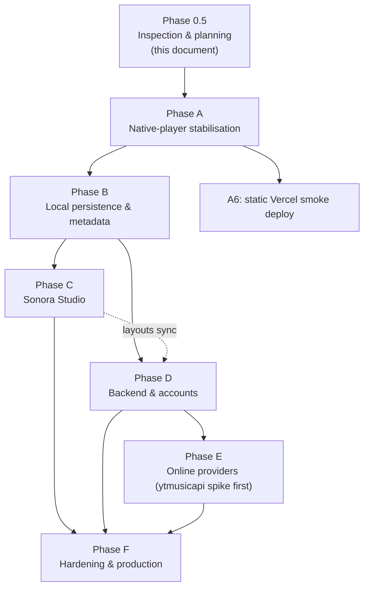

# Sonora — Roadmap & Status

> **Status of this document:** rewritten in *Phase 0.5 (inspection & planning)* from direct inspection of the repository at commit `a42bd9c` ("till Phase 3"). The previous `PLAN.md` described intended work; this one describes what the code does today.
> The original Phase 0 specification is preserved in git history (`git show a12dfb4:PLAN.md`, `git show a12dfb4:ARCHITECTURE.md`).

**Evidence tags used throughout**

| Tag | Meaning |
| :-- | :-- |
| **[V]** | *Verified by running the app* in headless Chrome during Phase 0.5 (throwaway probe, not committed). |
| **[C]** | *Code-read only* — derived from reading the source; not executed. Treat as high-confidence, not proven. |
| **[U]** | *Unverified* — a claim from docs/memory that could not be confirmed here. Must be validated before relying on it. |

---

## 1. Where the project actually is

**Current phase:** Phase 0.5 — Architecture, native-player audit & deployment planning (planning only; no code changed).
**Next implementation phase:** **Phase A — Native Player Stabilisation** (§5).

### 1.1 Headline finding

> **[V] The committed application does not boot.** `js/app.js:230` calls `mediaEngine.on('playing', …)`, but `MediaEngine` has no `on()` method. `init()` throws `TypeError: mediaEngine.on is not a function` after IndexedDB is opened and state is committed but **before** player controls, keyboard shortcuts, event bindings, drag-and-drop, subscriptions and the first render are set up.
> Observed result in a clean Chrome profile: 0 media cards rendered, sidebar navigation does nothing, Import button does nothing, no keyboard shortcuts. Only the static HTML shell renders.
>
> Everything marked "works" below was observed with that single line neutralised **in memory** by the probe (the repository file was not changed). Phase 2 and Phase 3 work therefore exists but has never been demonstrably working as committed.

### 1.2 Phase completion (original plan vs. repository evidence)

| Original phase | Claimed | Reality |
| :-- | :-- | :-- |
| 0 — Planning | Done | **Done**, but `ARCHITECTURE.md` described modules that were never written (`library.js`, `visualizer.js`), localStorage-only persistence (code uses IndexedDB) and a unified `<video>` element (code uses separate `<audio>` + `<video>`). |
| 1 — UI foundation | Done | **Done** [C]: `index.html` + 8 CSS files, 4 responsive breakpoints (1440/1024/768/480). Visual fidelity not reviewed in this phase. |
| 2 — Playback engine | Done | **Code present; blocked by boot crash.** With the crash bypassed [V], import, play/pause, auto-advance, rapid switching, error toasts work. Several defects below. |
| 3 — Library, playlists, persistence | Done | **Partial.** IndexedDB layer, playlists, favourites, queue, search/filter/sort exist. Relink is broken, history is never recorded, preferences barely persist, no library removal, no metadata, no repeat/shuffle UI. |
| 4 — Visualizer / Fullscreen / PiP / Media Session | Not started | **Not started.** Only `css/visualizer.css` scaffolding. No `AudioContext`, `mediaSession`, fullscreen or PiP code exists [V via grep]. Keyboard shortcuts (a Phase-4 item) *were* implemented early. |
| 5 — Polish & hardening | Not started | Not started. |

Git history: 6 commits, all 2026-10-22/23. The commit named "Phase 4 partial" contains only an empty `js.js`. The GitHub URLs `…/Sonora` and `…/Slip_Knot` resolve to the same repo (6 commits, same tree) [V]; the local `origin` still points at the old `Slip_Knot` name. `README.md` is a placeholder ("Slip_Knot / maa ka bhhh aag").

---

## 2. Feature status matrix (native player)

Legend: ✅ works · 🟡 partial · ❌ missing · ⛔ broken

### A. File importing
| Capability | Status | Evidence / notes |
| :-- | :-: | :-- |
| Single & multi-file picker (`<input multiple>`) | ✅ | [V] 3 of 4 files imported; 1 rejected. |
| Drag-and-drop files | 🟡 | [C] handler exists; not exercised. |
| Folder import | ❌ | No `webkitdirectory`, no `showDirectoryPicker`, no directory traversal on drop [V grep]. Dropping a folder is expected to be rejected as an unknown file — [U]. |
| Format validation | 🟡 | By MIME prefix then extension only. `.mkv` is accepted although most browsers can't decode it; no `canPlayType` advisory; zero-byte files not rejected [C]. |
| Metadata extraction | ❌ | Title = filename; `artist` hard-coded `"Local Media"`, `genre` `"Local Audio"`, `year` = file mtime year [C]. No ID3/Vorbis/MP4 parsing. |
| Album artwork | ❌ | Generated SVG poster per track; no embedded art. |
| Missing/invalid metadata fallbacks | 🟡 | Everything falls back to filename; but there is no real metadata to be "missing". |
| Unsupported files | ✅ | [V] `.txt` rejected with toast. Only the *first* rejection is reported [C]. |
| Corrupted files | 🟡 | [V] `corrupt.mp3` is accepted at import (extension-based), fails at play time with a toast, no crash. Auto-advance then **stalls** on it. |
| Duplicate avoidance | ⛔ | Heuristic (name+size+mtime ±2 s) exists, but: re-importing a *live* track revokes its object URL, leaving it unplayable **[V]**; in-batch duplicates are not detected and duplicate object URLs leak **[C]**. |
| Inaccessible files after reload | 🟡 | [V] marked "Offline" with a badge. **Relink is broken** via both the modal and re-import **[V]**. |

### B. Playback engine
| Capability | Status | Evidence / notes |
| :-- | :-: | :-- |
| Play / pause | ✅ | [V] button and Space. |
| Seek (scrubber, ±5/±10 s keys, 0–9 keys) | ✅ | [C]; scrubber commit-on-`change` logic is sound. `isSeeking` flag in the engine is dead code. |
| Previous / next | 🟡 | [V] next works. Prev "restart if >3 s" exists on the button but **not** on the `P` key; prev ignores shuffle [C]. |
| Volume / mute | 🟡 | Works at runtime [C]; **not persisted** [V]. |
| Playback speed | 🟡 | Works [C]; not persisted [V]; UI cycles 0.5–2.0 (engine allows 0.25). |
| Progress & duration display | 🟡 | Live display OK [V]. Duration is stored only on the in-memory item after first play, never persisted or re-rendered → library cards show `--:--` until played [C]. |
| Repeat modes | ⛔ | Logic exists (`off/all/one`) but **no UI control**; value is effectively fixed at `all` [V]. |
| Shuffle | ⛔ | Logic exists, **no UI control**. Algorithm is random-with-replacement; with repeat-off it never terminates (500 steps, no end) **[V]**. |
| Queue management | 🟡 | See §C. |
| Error handling | 🟡 | [V] decode errors surface a toast and don't crash; status ends `paused`+message, not `error`; no skip-on-error policy. |
| Rapid track switching | ✅ | [V] 31 rapid clicks → final state correct, one element playing. (Benign `AbortError` swallowed.) |
| Missing-file handling | 🟡 | Offline items open the relink modal (which then fails to relink). Auto-advance onto an offline/fixture item stops or pops a modal. |
| Element lifecycle / cleanup | ✅/🟡 | `src` removed + `load()` on switch (good). Object URLs live as long as the item (no removal feature, so never released); `cleanup()` exists but is never called [C]. |
| Continuity across navigation | ✅ | [C] `<audio>` lives outside re-rendered regions. |
| Keyboard / a11y | 🟡 | Global shortcuts with input guard exist. **[V]** Space on a focused library card both starts that track (card handler) *and* pauses it (global handler) → ends paused. |

### C. Queue and library
| Capability | Status | Evidence / notes |
| :-- | :-: | :-- |
| Add / remove / clear queue | ✅ | [C] and covered by `test-phase3.mjs` Test 8 (not run by me). |
| Reorder queue | ✅ | Up/down buttons only; no drag reordering. |
| Duplicates in queue | 🟡 | Disallowed (queue behaves as a set); can't enqueue a track twice. |
| Removing the playing track | ⛔ | `getNextTrack` falls back to `queue[0]` instead of the successor [C]. |
| Current index | ⛔ | `state.currentIndex` is unused; `saveQueue` always persists index 0; position is derived by `indexOf` [C]. |
| Shuffle preserving original order | ❌ | No separate original order is kept. |
| Search | ✅ | [V] runs; searches title/artist/genre/name/format. 111 filtered results from a 2,000-item library rendered in ~23 ms (partial probe; full unfiltered render **not** measured). |
| Sort / filter | ✅ | [C] name/date/duration/size; All/Audio/Video. Duration sort is wrong for unplayed tracks (see above). |
| Artist / album views | ❌ | Impossible until real metadata exists. |
| Favourites | 🟡 | Toggle + persistence [C]. **Defaults are re-seeded when the set is empty** (below). |
| Playlist CRUD & reorder | ✅/🟡 | [C]; native `confirm()` for delete; reorder indices use the *filtered* list (latent bug once library removal exists). |
| Remove track from library | ❌ | No UI; `storage.deleteLibraryItem` is never called [V]. |
| Empty library state | 🟡 | A state exists but is **never reached**: fixtures are seeded on first run (below). |
| Large-library performance | ❓ | Full `innerHTML` re-render + per-card listener re-attachment on every change; no virtualisation. Not measured at scale. |
| Recently played | ⛔ | Recording hook is the crashing call; nothing else invokes `recordPlayHistory` [C]. Always empty. |

### D. User experience
| Area | Status | Notes |
| :-- | :-: | :-- |
| Loading states | ❌ | No import progress; no "loading" indicator beyond engine status. |
| Empty states | 🟡 | Present per view; see above. |
| Playback errors | 🟡 | Toasts only, auto-dismiss; single shared toast element (a later toast overwrites an earlier one). |
| Responsive | ❓ | Breakpoints exist at 1440/1024/768/480 [C]; not visually reviewed. |
| Accessibility | 🟡 | `:focus-visible`, reduced-motion, labels present. Gaps: `role="button"` cards contain nested buttons; toast not an `aria-live` region; modal has `role="dialog"` but no focus trap/restore/accessible name; redundant `role="slider"` on native ranges. No automated audit run. |
| Success/failure feedback | 🟡 | Toasts exist; persistence failures are silent (D-16). |

### E. Persistence (as implemented)
| Data | Where | Survives reload? |
| :-- | :-: | :-- |
| Library metadata (+ SVG thumbnail data-URL per record) | IndexedDB `library` | ✅ [V] 11 cards after reload |
| File reference | none | ❌ Browser `File` objects are lost; items return as "Offline" **[V]** (3 offline after reload) |
| Queue (ids; index always 0) | IndexedDB `queue` | ✅ [V] length preserved |
| Playlists / favourites / history | IndexedDB | [C] persisted; history never written |
| Sort / filter / current view | localStorage `sonora_v1_preferences` | [C] saved on change |
| Volume / mute / speed / repeat / shuffle | — | ❌ **Not saved** — `localStorage` key stayed `null` after changing volume and speed; defaults restored after reload **[V]** |
| Audio blobs | IndexedDB `blobs` | ❌ Dead code: nothing writes it; restore path is wrong (see D-15) |

---

## 3. Known defects

Severity: **B**locker · **H**igh · **M**edium · **L**ow. Fix phase in the last column.

| ID | Sev | Evidence | Defect | Fix |
| :-- | :-: | :-: | :-- | :-: |
| D-01 | **B** | [V] | `app.js:230` calls nonexistent `mediaEngine.on()` → `init()` aborts; app is inert. | A1 |
| D-02 | H | [C] | Play history is never recorded (the only caller is D-01; engine has no event emitter). "Recent" view is always empty. | A3 |
| D-03 | H | [V] | Relink modal has no effect: `relinkMediaItem()` returns a *new* object; `app.js:1624` discards it. Item stays offline, modal reopens. | A2 |
| D-04 | H | [V] | Relink-by-reimport has no effect (`app.js:479` discards the return value) yet toasts "Re-linked 1 existing file". | A2 |
| D-05 | H | [V] | Re-importing an already-live file revokes its object URL (via `relinkMediaItem`) and keeps the old object → track unplayable until reload. | A2 |
| D-06 | H | [V] | Volume, mute, speed, repeat, shuffle never saved (FR-12 unimplemented). No repeat/shuffle UI. | A3 |
| D-07 | H | [C] | Defaults are re-seeded whenever favourites, playlists or the queue are *empty* on boot (`app.js:166-195`): un-favouriting everything, deleting every playlist or clearing the queue is silently undone on reload. A transient IndexedDB read failure followed by `saveFavourites()` (which `clear()`s the store) can wipe real favourites. | A2 |
| D-08 | H | [V] | 8 demo fixtures are written into the real library, queue (`trk_01,02,04`), favourites and a "Curated Highlights" playlist. They aren't playable; auto-advance/shuffle can land on them; imported tracks queue *after* them; "empty library" is unreachable. | A2 |
| D-09 | M | [V] | Auto-advance stalls at the first unplayable track; no skip policy; status ends `paused` rather than `error`. | A3 |
| D-10 | M | [V] | Space on a focused card is handled twice (card `keydown` + global `keydown`) → starts then pauses. | A4 |
| D-11 | M | [V]/[C] | Shuffle is random-with-replacement; with repeat-off it never ends [V]; no preserved original order; Prev ignores shuffle. | A3 |
| D-12 | M | [C] | Removing the playing track restarts the queue from index 0; `currentIndex` unused/persisted as 0; queue can't hold a track twice. | A3 |
| D-13 | M | [C] | In-batch duplicates not detected (`processFiles()` is called with an empty map); object URLs created for discarded duplicates are never revoked. | A2 |
| D-14 | M | [V] | No way to remove a track from the library; `deleteLibraryItem` is unused. | A2 |
| D-15 | M | [C] | Stored-blob path is dead and broken: `saveBlob` never called; restore calls `createBlobUrl(blob)` (signature is `(id, blob)`) and sets `objectUrl` while the engine reads `url`. | B1 |
| D-16 | M | [C] | Storage swallows every error (`resolve(false)`/`[]`); callers ignore results; no `onblocked`/`onversionchange`; no quota handling; "empty" and "read failed" are indistinguishable (feeds D-07). | B1 |
| D-17 | L | [C] | Durations not persisted/re-rendered → `--:--` on cards; duration sort unreliable. | A3 |
| D-18 | L | [C] | Only the first import rejection is shown; `.mkv` and zero-byte files accepted; no `canPlayType` check. | A2 |
| D-19 | L | [C] | Playlist detail reorder/remove uses indices of the *filtered* track list but `itemIds` may contain unresolved ids. Latent. | A2 |
| D-20 | L | [C] | Placeholder metadata (`"Local Media"`, genre, mtime-year) is shown as if real. | B2 |
| D-21 | L | [C] | Accessibility gaps listed in §2.D. | A4 |
| D-22 | L | [V] | `tests/test-phase3.mjs` is unreliable: prints `PASS` unconditionally for Tests 4a/4b/5; prints "ALL 10 TESTS EXECUTED SUCCESSFULLY" regardless of outcomes; hard-coded Chrome path and port 8085; no isolated profile (mutates the real profile's IndexedDB; Test 9 asserts `count===2`). Test 3 (`≥4 cards`) is expected to fail while D-01 exists (my probe saw 0 cards; I did not run the script itself). | A1 |
| D-23 | L | [V] | `tests/manual-test-checklist.md` covers Phase 2 only (plan promised 17 tracks); every box is unticked. | A5 |
| D-24 | L | [V] | No `.gitignore`, `package.json`, CI, or LICENSE. | A1 |
| D-25 | L | [C] | Documentation drift (README placeholder; old ARCHITECTURE described non-existent modules). | this phase (docs); README in A1 |
| D-26 | M | [C] | Two "current track" notions: `playNextTrack()`/`playPrevTrack()` start from `selectedMediaId`, not the track actually playing. Selecting (without playing) an offline card moves the "next" origin while another track continues. | A3 |

---

## 4. Native-player acceptance criteria (the Phase A/B exit gate)

Each criterion is measurable and mapped to a test layer (U = unit, E = browser E2E, M = manual). Test media are generated programmatically (sine-wave WAV, truncated/garbage files) — no copyrighted assets.

| ID | Criterion | Pass condition | Layer |
| :-- | :-- | :-- | :-: |
| AC-01 | **Boot** | Fresh profile: page loads, `pageerror`/unhandled-rejection count = 0, library shows an empty state (no fixtures). | E |
| AC-02 | **Import** | Importing a mixed batch (≥5 supported files + 1 `.txt` + 1 corrupt file): every playable file appears exactly once; non-media is rejected; **one** summary toast reports counts of added/duplicate/rejected with the first 3 names; zero uncaught errors. | E |
| AC-03 | **Dedupe** | Re-importing a file (alone, or twice in one batch) leaves library count unchanged **and the existing track remains playable** (`fetch(item.url)` succeeds). | U+E |
| AC-04 | **Transport** | Play/pause updates `element.paused` and state ≤100 ms; seek to 50 % lands within ±0.5 s; next/prev follow queue order; prev after >3 s restarts the track (button **and** `P` key); end of track advances ≤1 s. | E |
| AC-05 | **Rapid switching** | 50 consecutive switches within 2 s: final track = last requested; ≤1 media element unpaused; no unhandled rejection; no stale-`play()` error shown. | E |
| AC-06 | **Errors** | Corrupt/unsupported/missing file: status `error`, visible message, auto-advance skips to the next playable (cap: 5 consecutive skips, then stop with message); no crash. | U+E |
| AC-07 | **Queue** | Table-driven tests for add/remove/reorder/clear/play-next/remove-current (successor plays)/persist current index. | U |
| AC-08 | **Shuffle/repeat** | One full shuffle pass over *k* tracks visits each exactly once (100 randomised trials); toggling shuffle off restores original order and current track; repeat-off stops after last; repeat-all wraps; repeat-one loops; controls exist, are labelled, and persist. | U+E |
| AC-09 | **Playlists & favourites** | CRUD + reorder behave per spec; deleting a playlist never deletes tracks; unavailable tracks stay in playlists/favourites and are visibly flagged and skipped by playback; emptying favourites/playlists/queue **stays empty** after reload. | U+E |
| AC-10 | **Persistence** | After reload: library records, playlists, favourites, queue (+index), volume, mute, speed, repeat, shuffle, sort, filter, view all identical. Tracks are playable again after a single "Reconnect" action (ARCHITECTURE §5.4) with **unchanged ids**, so playlists/favourites are intact. | E |
| AC-11 | **Failure visibility** | With IndexedDB blocked/failing (simulated) or corrupted preferences JSON: app boots, shows a persistent visible warning, deletes no existing data, and never re-seeds defaults over real data. | U+E |
| AC-12 | **Resource release** | After loading/skipping 50 tracks: live object URLs ≤ number of *available* library items; none created for rejected/duplicate files; removing a track revokes its URL; idle media elements have no `src`. Heap snapshot comparison once in Chrome DevTools. | U+M |
| AC-13 | **Regression** | Every item in the regression list (search, filter, sort, favourites, playlist UI, queue drawer, keyboard shortcuts, drag-drop overlay, video playback smoke) passes; screenshots at 360/768/1024/1440 px reviewed. | E+M |
| AC-14 | **Accessibility** | Import → play → queue → add-to-playlist completable by keyboard only; Space on a focused card does not double-fire; toasts announced (`aria-live`); modals trap and restore focus; Lighthouse accessibility ≥ 90 (goal 95). | E+M |
| AC-15 | **Scale** | 2,000-track library: search keystroke→render ≤100 ms, first render ≤500 ms (measured). 10,000 tracks measured and a go/no-go on virtualisation recorded. | E |
| AC-16 | **Browsers** | Full pass: Chromium (Chrome/Edge). Import+playback+persistence pass: Firefox. Safari: smoke only, documented gaps. | M |

**File-reference limitation (must be explicit in the UI and docs):** a plain `<input type=file>`/drop yields a `File` valid only for the current page session. After reload it is gone. On Chromium, a stored `FileSystemFileHandle` can be re-used but only after the user re-grants permission, which may be re-prompted or revoked at any time. Sonora will therefore always model library items as *"metadata + a file binding that may be unavailable"* and provide a one-click reconnect path; it will never claim a file will remain accessible.

---

## 5. Roadmap

### 5.1 Dependency graph

Rules: nothing in C–F starts until the **Phase A exit gate (AC-01…AC-14)** passes. Phase C and D are independent of each other after B and may proceed in either order. Phase E depends on D (needs auth + server) and on the TrackRef/provider groundwork done in B.

### 5.2 Phase A — Native Player Stabilisation *(next)*

Goal: a trustworthy local-file player. **No new dependencies except (optionally, with owner approval) one dev-only E2E tool; no framework change; no rewrite.**

| Step | Work | Closes |
| :-- | :-- | :-- |
| **A1** Make it boot & make it testable | Fix D-01 minimally. Add `.gitignore`, minimal `package.json` (scripts only; no runtime deps). Make `app.js`/`file-handler.js` import-safe (no DOM/`window` at import) so unit tests can load them. Establish `node:test` unit harness (state, playlist/queue, media-engine with fake elements run in Node today — see ARCHITECTURE §10.2). Replace/repair `test-phase3.mjs` (isolated profile, real assertions, nonzero exit code). Add the no-uncaught-errors E2E smoke (AC-01). | D-01, D-22, D-24 |
| **A2** Import pipeline & data integrity | Single import orchestrator returning a structured result `{added, duplicates, relinked, rejected[]}`; in-batch + library dedupe; no URL leaks; fix relink (modal + reimport); never revoke a live URL; *remove-from-library* with cleanup of queue/playlists/favourites/history (with confirmation showing counts); remove fixture seeding (offer demo content only behind an explicit action, or delete `sample-data.js` usage); never re-seed over user data (first-run flag instead of "is empty"); single summary toast; `canPlayType` advisory; reject zero-byte. | D-03,04,05,07,08,13,14,18,19 |
| **A3** Engine, queue, preferences | Add a tiny event emitter to `MediaEngine` (`on('playing' \| 'ended' \| 'error' \| 'loaded', …)`), re-hook history; load-token to ignore stale `play()` results; `error` status + skip-on-error policy; queue model `{order, originalOrder, index}` (transport driven by the queue's current track, not `selectedMediaId`) with shuffle as a permutation, working repeat modes, prev/next semantics incl. shuffle, play-next, remove-current; repeat/shuffle UI buttons; persist volume/mute/speed/repeat/shuffle; persist duration after `loadedmetadata` and re-render the card. | D-02,06,09,11,12,17,26 |
| **A4** UX & accessibility | Fix Space double-handling; card markup without nested interactives; `aria-live` toast region (queue of toasts, not a single node); modal focus trap/restore/accessible name; import progress + disabled state for large batches; visual pass at 4 breakpoints; Lighthouse run. | D-10,21 |
| **A5** Acceptance run | Rewrite `tests/manual-test-checklist.md` against AC-01…AC-16, execute, record results with date/browser. | D-23 |
| **A6** *(small, early)* Static deployment smoke | Deploy the static site to Vercel as-is to prove the frontend constraint (ES modules, no build, HTTPS). No server code. See ARCHITECTURE §9. | — |

**Exit gate:** AC-01…AC-14 pass in Chromium; AC-16 Firefox pass recorded.

### 5.3 Phase B — Local library persistence & metadata

| Step | Work |
| :-- | :-- |
| **B1** Storage v2 | `Result`-returning storage API; surfaced `storageStatus` (`ready` / `memory-only` / `error`) with a persistent banner; DB v2 migration (`fileKey` index, `handles`, `artwork`, `meta` stores; `schemaVersion`); distinguish *empty* vs *failed*; request `navigator.storage.persist()`; JSON **backup/restore** of metadata (library records, playlists, favourites — no audio). Decide fate of the dead `blobs` store. Stop persisting per-record SVG data URLs. (D-15, D-16, AC-10/11) |
| **B2** Metadata & artwork | Spike then implement tag reading (see ARCHITECTURE §5.6); `title/artist/album/trackNo/duration/artwork`; filename fallback (`Artist - Title`); artwork stored as Blob, not data URL. Replace placeholder fields (D-20). |
| **B3** Reconnect UX | "Reconnect library" flow: (1) universal — re-pick files/folder (`<input multiple>`, `webkitdirectory`), match by fingerprint; (2) Chromium enhancement — stored `FileSystemFileHandle`/`DirectoryHandle` with `queryPermission`/`requestPermission`. Feature-detected, isolated in `file-access.js`. |
| **B4** Library views | Artist / album / track views; search over new fields; sort; list-vs-grid; virtualisation decision from AC-15 data. |
| **B5** Forward-compat groundwork (cheap, no online code) | Introduce `trackKey` (portable fingerprint) and namespaced `TrackRef` (`local:<id>`) in queue/playlist records so later sync and providers don't require a data migration. |

**Exit gate:** AC-09/10/11/15 pass with real metadata; backup → wipe → restore round-trip verified.

### 5.4 Phase C — Sonora Studio *(deferred; do not start before B)*
C0 refactor app.js into services + components (**prerequisite**, behaviour-preserving) → C1 component registry + layout document + 2–3 built-in layouts → C2 edit mode (select/move/resize/z-order/hide/lock, snapping & guides, keyboard nudge) → C3 styling panel (tokens → per-component overrides) → C4 undo/redo, multiple saved layouts, restore default, safe mode → C5 advanced (custom CSS, visual components incl. visualiser, responsive variants). Details & risks: ARCHITECTURE §6. Gate: moving/resizing/restyling never interrupts playback or touches library data (AC-S1…S5 defined in ARCHITECTURE §6.8).

### 5.5 Phase D — Backend & accounts *(deferred)*
D0 repo restructure for deployment (`public/` vs root decision) + `package.json` workspaces decision + Docker Compose for local Mongo → D1 Express skeleton, health route, Mongoose connection (serverless-safe), validation → D2 auth (register/login/logout, sessions, CSRF, rate-limit) → D3 sync of preferences, playlists, favourites (local-first, optional account) → D4 Studio layout sync (after Phase C). Details: ARCHITECTURE §7 and §9.

### 5.6 Phase E — Online music *(deferred; spike first)*
E0 validation spike answering the questions in ARCHITECTURE §8.4 (legal/ToS, auth, rate limits, hosting, playback path) **before any code lands in the product** → E1 provider interface + `LocalProvider` retrofit → E2 YouTube Music search/metadata/library read via `ytmusicapi` Python service → E3 playback via a sanctioned path only (to be determined by E0).

### 5.7 Phase F — Hardening & production
CI (unit + E2E + build check), Lighthouse budget, security review (auth, CSP, custom-CSS sanitisation), logging/observability, backup/restore, load testing of sync, accessibility audit, documentation (real README), release checklist.

---

## 6. Deferred / out of scope until their phase

| Item | Deferred to | Reason |
| :-- | :-: | :-- |
| Visualizer (Web Audio), Fullscreen, PiP | C5 (visual components) | Visualizer is a Studio component; needs an `AudioGraph` service and a decision on the two-element (audio/video) design. |
| Media Session API | B (optional, small) | Cheap and valuable but not required for the native-player gate. |
| Theme marketplace / sharing | Not planned | Explicitly out of scope. |
| Accounts, MongoDB, Express, ytmusicapi, Python service | D–E | Must not be introduced during A–C. |
| Docker/Vercel *files* | D0 (Docker, `vercel.json`), A6 (none needed for static) | No server exists yet; avoid speculative infrastructure. |
| Offline audio copies (IndexedDB/OPFS) | Post-B, optional | Quota/eviction risk; only as explicit "keep a copy" opt-in. |
| Video-specific work | Maintained, not extended | Video playback must not regress, but acceptance criteria prioritise audio. |

---

## 7. Open decisions (need the project owner)

1. **E2E tool:** harden the existing zero-dependency CDP script, or accept Playwright as a *dev-only* dependency (recommended; real `setInputFiles`, Chromium+Firefox+WebKit)? Either is compatible with the constraints; the choice affects A1.
2. **Fixtures:** delete demo data entirely, or keep an explicit "Load demo library" action? (Recommended: delete; use generated test media in tests.)
3. **Tag-parsing approach:** hand-written minimal parsers vs vendoring a library (ARCHITECTURE §5.6). Decide after the B2 spike.
4. **Visualiser vs video:** audio-only visualiser, or unify to one media element (reverses the current two-element design)? Decide at C0/C5.
5. **Deployment layout:** keep `index.html` at repo root, or move static assets into `public/` when Express arrives (Vercel ignores `express.static()`; see ARCHITECTURE §9.1).
6. **Repo hygiene:** update `origin` URL to `…/Sonora`; replace placeholder README (not changed in this phase because only planning docs were in scope).
