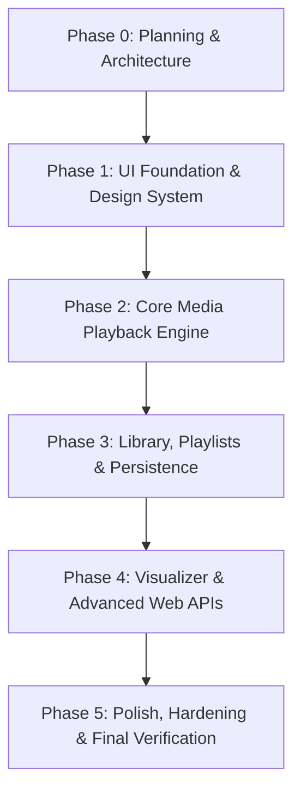

# Sonora — Project Implementation Plan

## 1. Project Overview & Objectives

**Sonora** is a cinematic, browser-native local media player engineered exclusively with HTML5, CSS3, and vanilla JavaScript (ES Modules). Designed for local desktop and mobile environments without requiring a server backend, user authentication, or cloud uploads, Sonora prioritizes privacy, lightning-fast responsiveness, zero configuration, and a sleek, media-focused user experience.

### Primary Objectives
* **True Local-First Experience**: Enable instant drag-and-drop or file-picker playback of user-selected local audio and video files without uploading bytes to any remote server.
* **Cinematic Dark Aesthetics**: Provide an interface with charcoal and obsidian surfaces, restrained violet accents, refined typography, and smooth micro-interactions that elevate media presentation.
* **Zero Dependencies & Zero Build Step**: Deliver production-grade architecture using standard Web APIs, vanilla CSS, and native ES Modules that run seamlessly on any lightweight local static HTTP server (e.g., Python's `http.server`, Node's `serve` or `http-server`, VS Code Live Server).
* **Robust Media Lifecycle & Resource Safety**: Prevent memory leaks by strictly managing object URLs, detached DOM nodes, Canvas animation loops, and Web Audio resources.
* **Modular & Extensible Architecture**: Structure the codebase with clean separations of concern (single responsibility principle, unidirectional data flow, event-driven communication) to facilitate straightforward testing and long-term maintenance.

---

## 2. Requirements Specification

### 2.1 Functional Requirements

| ID | Feature | Description | Target Phase |
| :--- | :--- | :--- | :--- |
| **FR-01** | Multi-Format Local Playback | Seamless playback of native browser-supported audio (`.mp3`, `.wav`, `.ogg`, `.aac`, `.flac`, `.m4a`) and video (`.mp4`, `.webm`, `.ogv`, `.mov`). | Phase 2 |
| **FR-02** | Batch File Ingestion | Ingest single files, multiple selected files, or folders via standard `<input type="file">` and native Drag-and-Drop APIs. | Phase 2 |
| **FR-03** | Custom Media Controls | Cinematic custom transport controls: Play/Pause, Replay 10s, Skip 10s, Previous/Next track, Stop, and Mute toggle. | Phase 2 |
| **FR-04** | Precision Seek & Scrubber | Interactive timeline scrubber bar with hover timestamp preview, buffered range visualization, and live elapsed/remaining time displays. | Phase 2 |
| **FR-05** | Audio Management | Logarithmic volume slider, one-click mute/unmute toggle, and dynamic volume icon states (muted, low, mid, high). | Phase 2 |
| **FR-06** | Variable Speed Playback | Selectable playback speeds (`0.25x`, `0.5x`, `0.75x`, `1.0x`, `1.25x`, `1.5x`, `1.75x`, `2.0x`) with pitch correction enabled. | Phase 2 |
| **FR-07** | Media Library & Thumbnails | Visual library displaying all ingested media items with metadata (filename, duration, format, file size) and auto-generated video frame thumbnails. | Phase 3 |
| **FR-08** | Real-Time Search & Filtering | Instant client-side text search across filenames and metadata, with format filtering (All, Video, Audio). | Phase 3 |
| **FR-09** | Library Sorting | Multi-criteria sorting: Name (A-Z / Z-A), Date Added, Duration, and File Size. | Phase 3 |
| **FR-10** | Queue & Playlists | Dynamic active playback queue with reordering, clear queue, custom named playlists, and repeat (off, all, one) / shuffle modes. | Phase 3 |
| **FR-11** | History & Favourites | Quick-access toggles for marking tracks as Favourites and an automatically maintained "Recently Played" history ledger. | Phase 3 |
| **FR-12** | Persistent Preferences | Persist non-transient user settings (volume, muted, speed, repeat, shuffle, active theme accent, visualizer mode) in `localStorage`. | Phase 3 |
| **FR-13** | Audio Visualizer | Real-time Canvas-based audio visualizer (Frequency Bar Spectrum, Oscilloscope Waveform, Circular Pulse) powered by Web Audio API (`AnalyserNode`). | Phase 4 |
| **FR-14** | Keyboard Control System | Comprehensive, accessible keyboard shortcuts for all primary transport actions, with active focus detection to avoid collisions with text inputs. | Phase 4 |
| **FR-15** | Fullscreen & PiP | Native Fullscreen API integration for the media container and Picture-in-Picture (PiP) support for video elements with graceful fallbacks. | Phase 4 |
| **FR-16** | Media Session Integration | System-level media notification support via `navigator.mediaSession` (album art, title, play/pause, prev/next, seek handlers) on supported platforms. | Phase 4 |
| **FR-17** | Error & Format Handling | Non-blocking inline toast/banner notifications for unsupported codecs, corrupted files, and permission failures. | Phase 2, 5 |

### 2.2 Non-Functional Requirements

* **Performance & Frame Rate**:
  * Scrubber tracking and canvas visualizer rendering must maintain a consistent 60 FPS under normal CPU loads.
  * Library search and filtering across up to 1,000 in-memory items must execute in under 16ms (within a single frame budget).
  * Video thumbnail extraction must use off-screen elements throttled sequentially to prevent UI thread lockup.
* **Memory Management**:
  * Stale `blob:` Object URLs must be systematically revoked when items are deleted or replaced.
  * Audio nodes must disconnect cleanly; Canvas rendering loops (`requestAnimationFrame`) must cancel immediately when the visualizer is idle or hidden.
* **Responsiveness**:
  * Fluid desktop layouts (1920x1080 down to 1024x768) and adaptive mobile/tablet layouts (down to 360px viewport width) with touch-friendly targets (minimum 44x44px).
* **Accessibility (a11y)**:
  * High-contrast interface conforming to WCAG AA guidelines (contrast ratio > 4.5:1 for text).
  * Meaningful `aria-label`, `aria-valuenow`, `role="slider"`, and keyboard navigation (`Tab`, `Space`, `Enter`, arrows) across custom controls.
* **Resilience**:
  * Graceful degradation when advanced browser features (e.g., `navigator.mediaSession`, Picture-in-Picture, Web Audio API) are missing or disabled.
  * Safe recovery from corrupted `localStorage` structures without runtime crashes.

---

## 3. Technology Choices & Justification

| Technology | Selection | Rationale |
| :--- | :--- | :--- |
| **Core Architecture** | HTML5 / CSS3 / Vanilla ES Modules (`import`/`export`) | Eliminates build tools (Webpack, Vite, Rollup), bundling latency, and dependency bloat. Provides native modularity directly understood by all modern browsers. |
| **Frameworks** | *None* (No React, Vue, Svelte, or TypeScript) | Maximizes portability, minimizes overhead, keeps runtime footprint negligible, and ensures the code remains inspectable and educational. |
| **Media Player Backbone** | Unified Native `<video>` Element | An HTML5 `<video>` element natively handles both video and audio streams seamlessly. Using a single media element avoids the need to synchronize two separate elements (`<audio>` and `<video>`) or rebind the Web Audio node tree when switching media types. |
| **Audio Processing** | Web Audio API (`AudioContext`, `AnalyserNode`, `MediaElementAudioSourceNode`) | Standard browser pipeline for high-performance, real-time frequency and time-domain analysis. |
| **Visualizer Rendering** | HTML5 Canvas 2D (`CanvasRenderingContext2D`) | High-performance raster rendering via `requestAnimationFrame` with low overhead for spectrum bars and waveforms; avoids WebGL complexity. |
| **State Management** | Centralized Reactive Store (Pub/Sub pattern in vanilla JS) | Simple, deterministic state management without external dependencies. Dispatches predictable state snapshots to registered listeners. |
| **Persistence** | `localStorage` + Memory Index | Instant synchronous key-value retrieval for preferences, playlists, and history. Strict boundaries: only JSON-serializable metadata is stored; raw media buffers/Blobs are never placed in storage. |
| **Development Server** | Lightweight Static HTTP Server | Native ES modules require an HTTP/HTTPS origin (CORS restrictions prevent loading modules via `file://`). Any basic server (Python `http.server`, Node `npx serve`, or Live Server) is sufficient. |

---

## 4. Proposed Project Structure

To maintain a clean, maintainable architecture, the proposed structure organizes files by domain:

```
sonora/
├── index.html                      # Semantic single-page application entry point
├── README.md                       # Project documentation, quickstart, and features
├── PLAN.md                         # Implementation plan, phases, and verification roadmap
├── ARCHITECTURE.md                 # System architecture, data flow, and design specifications
│
├── assets/
│   ├── icons/                      # SVG icon sprites or individual iconography
│   └── images/                     # Fallback album art, placeholders, brand marks
│
├── css/
│   ├── reset.css                   # Modern CSS reset and box-sizing defaults
│   ├── variables.css               # Design tokens: palette, typography, spacing, elevation
│   ├── layout.css                  # App shell, grid, sidebar, and view transitions
│   ├── components.css              # Generic components: buttons, inputs, sliders, tooltips, dialogs
│   ├── player.css                  # Cinematic player bar, controls, scrubber, time displays
│   ├── library.css                 # Media cards, table views, search bar, filter pills
│   ├── visualizer.css              # Canvas viewport, visualizer overlay, and display controls
│   └── responsive.css              # Breakpoints, mobile overlays, and touch-target adaptations
│
├── js/
│   ├── app.js                      # Application bootstrap, DI container, and coordinator
│   ├── state.js                    # Centralized reactive state store and dispatch system
│   ├── storage.js                  # Persistent storage adapter with schema migration & validation
│   ├── file-handler.js             # Drag-and-drop, file picker, validation, and object URL factory
│   ├── media-engine.js             # Unified media element wrapper, event bridge, and playback API
│   ├── player-controls.js          # Control bar UI bindings, scrubber tracking, and slider inputs
│   ├── library.js                  # Library catalog rendering, search filter, and thumbnail pipeline
│   ├── playlist.js                 # Queue manager, playlist CRUD, shuffle/repeat algorithms
│   ├── visualizer.js               # Web Audio graph lifecycle and Canvas 2D animation loop
│   ├── keyboard.js                 # Global shortcut registry with input focus guard
│   └── utils.js                    # Formatting (time, bytes), debounce, throttle, DOM helpers
│
└── tests/
    └── manual-test-checklist.md    # Comprehensive step-by-step validation guide
```

### Justification of Boundaries
* **Separation of CSS by Concern**: Isolating `player.css`, `library.css`, and `visualizer.css` prevents style coupling and allows independent refinement of the player chrome vs catalog views.
* **Dedicated Module Boundaries**:
  * `media-engine.js` encapsulates all direct interactions with HTMLMediaElement, preventing other modules from scattering ad-hoc media listeners.
  * `file-handler.js` isolates file ingestion and Blob URL creation, keeping DOM event handling out of business logic.
  * `state.js` acts as the single source of truth; no module mutates another module's local state.

---

## 5. Implementation Roadmap (Phases 0–5)



---

### Phase 0 — Planning and Architecture *(Current Phase)*
* **Objective**: Complete architectural blueprint, state contracts, media lifecycle planning, risk analysis, and project documentation before creating source code.
* **Features**: System design, module interface specification, data flow definition, ADRs.
* **Files Created/Modified**: `PLAN.md`, `ARCHITECTURE.md`.
* **Dependencies**: None.
* **Technical Risks**: Incomplete lifecycle specification leading to memory leaks or brittle module coupling during implementation.
* **Acceptance Criteria**:
  1. Detailed `PLAN.md` covering all 17 functional requirements and phased roadmap.
  2. Detailed `ARCHITECTURE.md` specifying module interfaces, state model, media lifecycle, Web Audio graph, and risk mitigation.
  3. No application UI or runtime JavaScript written during this phase.
* **Smallest Milestone**: Full sign-off on `PLAN.md` and `ARCHITECTURE.md`.

---

### Phase 1 — UI Foundation & Design System
* **Objective**: Implement the semantic HTML5 structure, CSS variables, typography, layout grid, dark cinematic theme, responsive shell, and interactive mock component states.
* **Features**:
  * Root layout: collapsible sidebar navigation, top header bar (search/actions), main viewport area, and bottom player bar.
  * Empty states for library, queue, and visualizer.
  * Accessible design tokens (colors, radii, shadows, typography scale) in `variables.css`.
  * Fully responsive shell adapting across desktop, tablet, and mobile viewports.
* **Files Expected to Change**:
  * `index.html`
  * `css/reset.css`, `css/variables.css`, `css/layout.css`, `css/components.css`, `css/player.css`, `css/library.css`, `css/visualizer.css`, `css/responsive.css`
* **Dependencies**: Completion of Phase 0.
* **Technical Risks**: Layout reflows on mobile viewports; flex/grid overflows in the player scrubber.
* **Acceptance Criteria**:
  1. Semantic HTML5 page renders crisply in all modern browsers without console errors.
  2. All CSS tokens loaded and verified via inspect tools.
  3. Layout adapts fluidly from 360px to 2560px screen widths.
  4. Interactive mock elements (buttons, sliders, tabs) show correct hover, focus, and active states.
* **Smallest Milestone**: Static app shell rendering the dark cinematic theme with empty states and mock controls.

---

### Phase 2 — Core Media Playback Engine
* **Objective**: Build file selection, drag-and-drop ingestion, the unified media engine, custom player controls, seeking, volume, and playback speed.
* **Features**:
  * Ingestion via `<input type="file" multiple>` and drag-and-drop zone.
  * Object URL creation with registry tracking and validation for media MIME types.
  * Core `MediaEngine` wrapping `<video>` element with playback events synced to `State`.
  * Custom player controls: play/pause, seek scrubber with time tooltip, volume slider, mute toggle, speed selector.
  * Toast notifications for unsupported formats or load errors.
* **Files Expected to Change**:
  * `js/app.js`, `js/state.js`, `js/utils.js`, `js/file-handler.js`, `js/media-engine.js`, `js/player-controls.js`
* **Dependencies**: Phase 1 UI shell.
* **Technical Risks**:
  * Object URL leaks on rapid file switching.
  * Audio/video codec decode failure causing unhandled media element errors.
* **Acceptance Criteria**:
  1. User can drag and drop or select local audio/video files.
  2. Media plays with synchronized time, duration, and scrubber updates.
  3. Seeking, volume adjustments, and speed changes work smoothly with pitch correction.
  4. Unsupported or corrupted files trigger graceful error toasts without crashing the player.
* **Smallest Milestone**: Single video/audio file drag-and-drop playback with functional play/pause, seek, and volume controls.

---

### Phase 3 — Library, Playlists & Persistence
* **Objective**: Build the media catalog, client-side search, multi-criteria sorting, video thumbnail extraction, playlists, queue management, and localStorage synchronization.
* **Features**:
  * Media library view rendering cards with metadata (file size, duration, format badge).
  * Asynchronous video thumbnail generation using off-screen canvas snapshotting.
  * Real-time search by filename with format filter pills (All, Audio, Video).
  * Sorting by Name, Date Added, Duration, and Size.
  * Playback queue with Next/Previous navigation, reordering, and Repeat (Off/All/One) / Shuffle modes.
  * Favourites toggle and auto-updating "Recently Played" history.
  * Persistence layer syncing user preferences and playlist metadata to `localStorage`.
  * Graceful handling of missing files on app reload (indicating files require re-selection).
* **Files Expected to Change**:
  * `js/library.js`, `js/playlist.js`, `js/storage.js`, `js/state.js`, `css/library.css`
* **Dependencies**: Phase 2 playback engine.
* **Technical Risks**:
  * Heavy canvas snapshotting freezing the UI when loading large media batches.
  * `localStorage` quota exceeded when storing large metadata sets.
* **Acceptance Criteria**:
  1. Multiple files load into library with correct duration and metadata.
  2. Video items display generated thumbnail images.
  3. Search and sorting update the displayed items in real time.
  4. Queue functions accurately with repeat and shuffle modes.
  5. Reloading the app restores preferences (volume, speed, theme) and displays persistent playlist names.
* **Smallest Milestone**: Multi-file library with search, sort, and consecutive queue playback.

---

### Phase 4 — Visualizer & Advanced Web APIs
* **Objective**: Implement the Web Audio API Canvas visualizer, keyboard shortcuts, Fullscreen API, Picture-in-Picture, and Media Session API.
* **Features**:
  * Web Audio pipeline (`AudioContext`, `AnalyserNode`, `MediaElementAudioSourceNode`).
  * Multiple visualizer modes: Spectrum Bars, Oscilloscope Waveform, Circular Audio Pulse.
  * Fullscreen toggle for video/visualizer container with auto-hiding controls.
  * Picture-in-Picture (PiP) toggle for video streams with capability check.
  * System Media Session API integration (lock-screen / OS notification media controls).
  * Global keyboard shortcuts with input-focus guards (Space, Arrow keys, M, F, J, L, etc.).
* **Files Expected to Change**:
  * `js/visualizer.js`, `js/keyboard.js`, `css/visualizer.css`, `js/app.js`
* **Dependencies**: Phases 2 and 3.
* **Technical Risks**:
  * Browser autoplay policy blocking `AudioContext` until explicit user interaction.
  * `createMediaElementSource` calling error if invoked multiple times on the same element.
  * Fullscreen or PiP API unsupported on specific browsers (e.g., Firefox mobile, Safari variants).
* **Acceptance Criteria**:
  1. Audio playback drives real-time Canvas visualization at 60 FPS without audio dropouts.
  2. Visualizer stops rendering when paused or hidden to conserve battery/CPU.
  3. Keyboard shortcuts operate transport controls reliably and ignore keystrokes inside text inputs.
  4. Fullscreen and PiP activate on supported browsers and fail gracefully with informative UI feedback when unsupported.
  5. OS-level media keys and notifications reflect the currently playing media item.
* **Smallest Milestone**: Working audio visualizer switching between bar and waveform modes during audio playback.

---

### Phase 5 — Polish, Hardening & Final Verification
* **Objective**: Conduct comprehensive edge-case testing, memory leak auditing, accessibility audit, performance tuning, and documentation finalization.
* **Features**:
  * Strict memory profiling: verifying Object URL revocation and Canvas/Audio cleanup.
  * Accessibility improvements: ARIA live regions, focus styling, high contrast verification.
  * Complete user documentation in `README.md` and verification records in `manual-test-checklist.md`.
* **Files Expected to Change**:
  * `README.md`, `tests/manual-test-checklist.md`, minor bug fixes across all JS/CSS files.
* **Dependencies**: Phases 1–4.
* **Technical Risks**: Subtle race conditions during rapid file deletion or fast track skipping.
* **Acceptance Criteria**:
  1. All scenarios in `manual-test-checklist.md` pass across Chrome, Firefox, and Edge.
  2. Memory footprint remains stable after loading and skipping 50+ media items.
  3. Lighthouse Accessibility score > 95.
* **Smallest Milestone**: Zero console warnings or errors across complete playback workflows.

---

## 6. Testing Strategy

### 6.1 Manual Test Checklist Structure
The test plan covers 17 dedicated verification tracks documented in `tests/manual-test-checklist.md`:
1. **Empty State**: First-run experience, empty library notices, disabled control states.
2. **Single-File Audio Ingestion**: MP3/WAV/FLAC load, playback, seek, time updates.
3. **Single-File Video Ingestion**: MP4/WebM load, aspect ratio preservation, video rendering.
4. **Batch Ingestion**: Loading 20+ mixed files simultaneously via file dialog and drag-and-drop.
5. **Seeking & Timeline**: Rapid seeking, dragging scrubber handle, boundary conditions (0s and end).
6. **Volume & Speed Control**: Mute toggle, level persistence, speed pitch preservation.
7. **Queue Navigation**: Auto-advance on track completion, manual Next/Previous, empty queue behavior.
8. **Shuffle & Repeat**: Repeat One (loops same track), Repeat All (loops playlist), Shuffle (non-repeating random order).
9. **Invalid & Corrupt Files**: Ingesting non-media files (`.txt`, `.exe`, zero-byte files) — verify error toasts.
10. **Unsupported Codecs**: Ingesting unsupported containers/codecs — verify non-crashing graceful error.
11. **Browser Refresh / Restart**: Verify preferences persist; verify metadata persists with "Re-link file" state.
12. **Storage Corruption Recovery**: Ingesting malformed JSON into `localStorage` — verify automatic recovery.
13. **Search & Filter**: Real-time debounce query, combined format filter + text search.
14. **Playlist CRUD**: Create playlist, add tracks, reorder, remove tracks, delete playlist.
15. **Audio Visualizer**: Mode switching, resize handling, audio pause freeze/stop, resume after background tab.
16. **Fullscreen & PiP**: Enter/exit fullscreen, PiP toggle, browser permission fallback.
17. **Keyboard Navigation & Accessibility**: Full keyboard traversal without mouse, no shortcut collisions in search input.

### 6.2 Cross-Browser Verification Matrix
* **Chromium (Chrome, Edge, Brave)**: Primary target; full support for Media Session, PiP, Fullscreen, Web Audio.
* **Gecko (Firefox)**: Verification of Web Audio graph, custom styling of sliders/scrollbars, Fullscreen API differences.
* **WebKit (Safari Desktop / Mobile)**: Autoplay policy verification, audio context user gesture unlocks, PiP prefix support.

---

## 7. Major Technical Risks & Mitigation Plan

| Risk | Severity | Root Cause | Architectural Mitigation |
| :--- | :---: | :--- | :--- |
| **Object URL Memory Leaks** | High | `URL.createObjectURL` allocates browser C++ heap references that are not garbage collected automatically. | Centralize all object URL creation in a single `ObjectUrlRegistry` inside `file-handler.js`. Enforce automatic revocation whenever an item is replaced, deleted, or when the window unloads (`beforeunload`). |
| **Web Audio Node Re-Attachment Crash** | High | Calling `createMediaElementSource(element)` more than once on the same `<video>` element throws an uncatchable `InvalidStateError`. | Initialize the `MediaElementAudioSourceNode` exactly once during application bootstrap in `visualizer.js`, keeping the source node connected to a master gain node that bridges to `destination` and `AnalyserNode`. |
| **AudioContext Autoplay Block** | Medium | Modern browsers suspend new `AudioContext` instances created before an explicit user interaction. | Instantiate or resume `AudioContext` only inside a direct user gesture handler (e.g., initial click on Play button or drag-and-drop event). Check `audioCtx.state === 'suspended'` and call `resume()`. |
| **Local File Volatility Across Reloads** | Medium | Browsers cannot persist raw `File` objects or active `blob:` URLs across browser refreshes for security reasons. | Persist file metadata (name, size, type, duration) to `localStorage`, but mark the runtime file reference as `unloaded`. Display a sleek "Re-link File" badge in the UI that lets users reconnect the folder or file. |
| **Video Thumbnail Generation Freezing UI** | Medium | Creating off-screen video elements and seeking them simultaneously to capture canvas snapshots exhausts browser memory. | Implement a throttled, sequential thumbnail queue that processes at most one video frame capture at a time, using a small off-screen canvas (e.g., 320x180) and yielding to the main thread via `requestIdleCallback` or `setTimeout`. |
| **Keyboard Shortcut Collisions** | Low | Pressing `Space` to pause or `F` for fullscreen while typing in the Search input causes unintended player actions. | In `keyboard.js`, inspect `event.target`. If the active target is an `HTMLInputElement`, `HTMLTextAreaElement`, or has `isContentEditable`, immediately bypass all global shortcut handlers. |
| **Storage Quota Exceeded** | Low | Storing large data URLs (like thumbnails) in `localStorage` quickly hits the ~5MB quota limit. | Never store thumbnail image blobs or base64 strings in `localStorage`. Only store lightweight JSON metadata (strings, numbers, booleans). Generate thumbnails on-the-fly in memory per session. |
